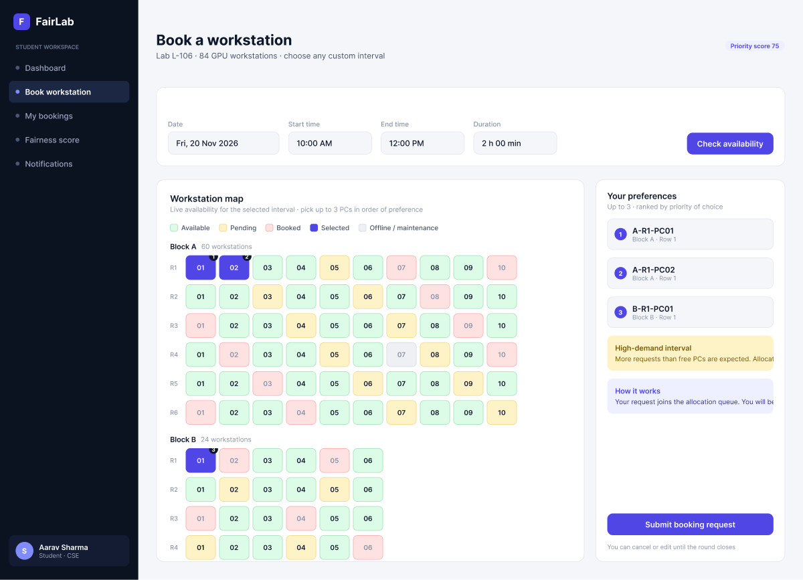
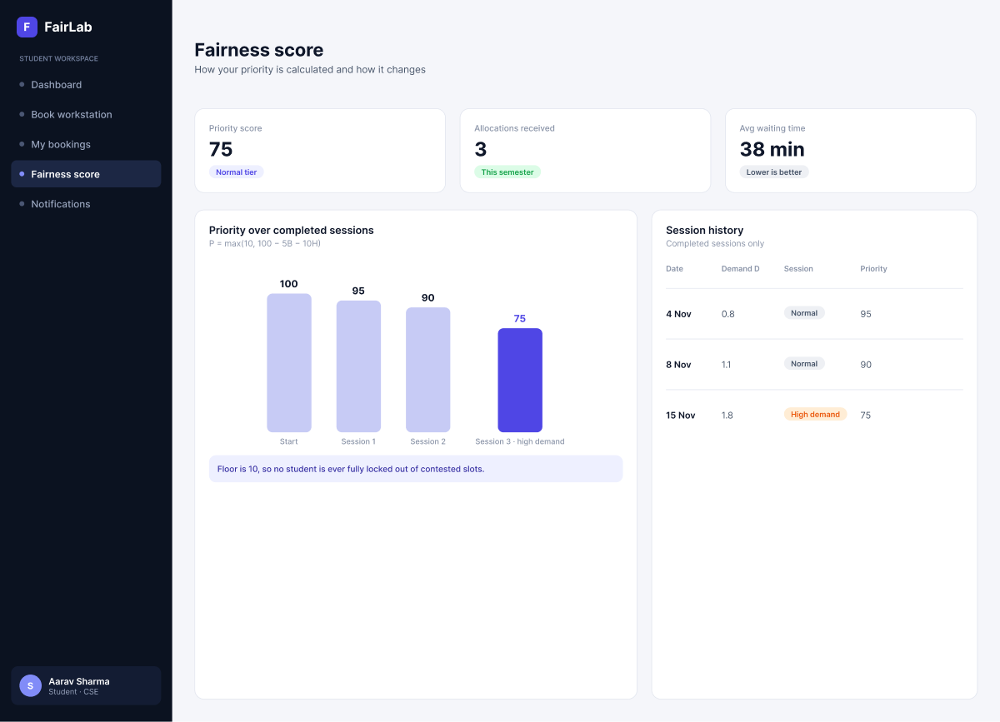
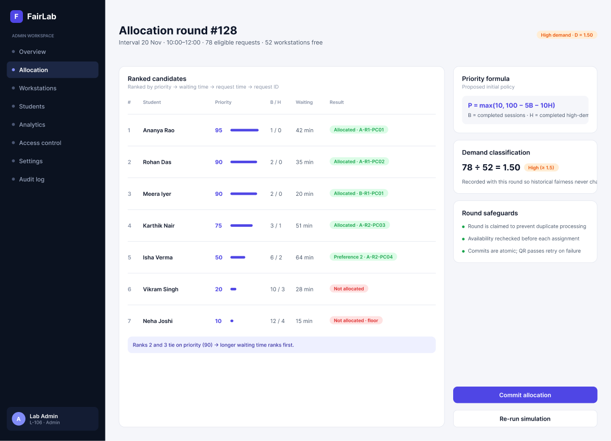
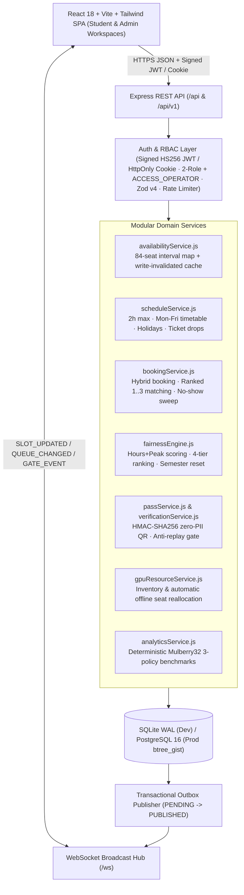
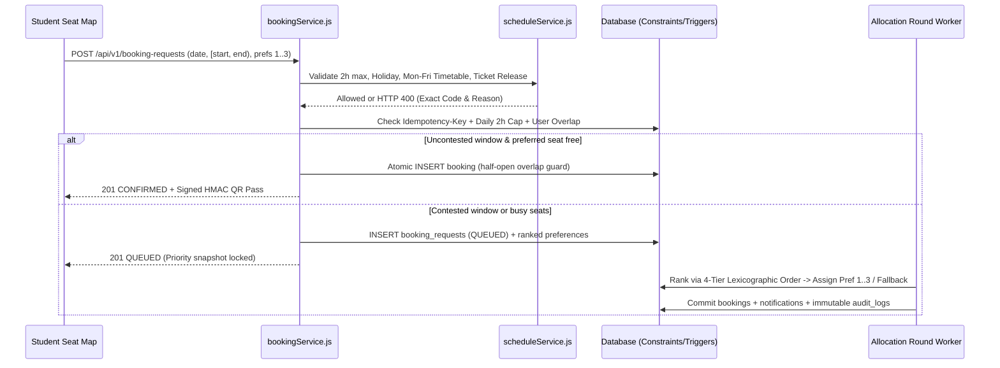
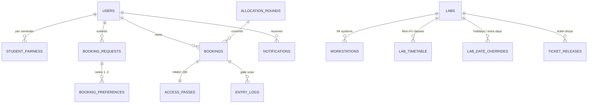

<div align="center">

# FairLab

### Fairness-Aware Workstation Reservation, Scheduling & Cryptographic Gate Access Platform

**IIT Bhilai · Computer Lab L-106 · 84 Workstations (Block A `6×10` + Block B `4×6`)**

[](#system-architecture)
[](#backend-engineering--api-reference)
[](#database-invariants--concurrency-control)
[](#frontend-workspaces--ui-themes)
[](#verification--adversarial-testing)
[](#security-rbac--anti-abuse-hardening)

*Movie-seat visual booking meets mathematically verified fair scheduling, academic timetable governance, ticket drops, and database-enforced zero-overlap guarantees.*

[Architecture](#system-architecture) · [Fairness Model](#mathematical-fairness-model) · [Schedule & Tickets](#schedule-governance--ticket-releases) · [Security](#security-rbac--anti-abuse-hardening) · [Quickstart](#quickstart--local-development) · [VM Production Sizing](#production-vm-deployment-10-vcpu--10-gb-ram)

</div>

---

## Why FairLab Exists

Shared university compute laboratories suffer from four classic systems failures under naive First-Come-First-Served (FCFS / FIFO) booking tools:

| Failure Mode | Naive FCFS Outcome | FairLab Engineering Solution |
| :--- | :--- | :--- |
| **Bot & Latency Advantage** | Automated scripts submitting in `5–15 ms` monopolize peak slots (`Gini = 0.657`, `Max Wait = 98 cycles`). | Duration & high-demand priority scoring + 4-tier deterministic tie-breaking (**`Gini = 0.022`**, **`Jain = 0.998`**, **`Max Wait = 6.7 cycles`**). |
| **Double Booking Under Races** | Concurrent requests for the same seat or overlapping intervals corrupt reservations. | Half-open `[start, end)` DB exclusion constraints (PostgreSQL 16 `btree_gist` `23P01` + SQLite `BEFORE INSERT` triggers) + idempotency keys. |
| **Academic Timetable Clashes** | Students book seats during scheduled Mon–Fri university lab courses or institute holidays. | First-class Mon–Fri academic timetable blocking, Holiday / Extra-Day custom hours overrides, strict 2-hour max limit, and Admin Ticket Releases. |
| **Unverified Gate Entry** | Static screenshots or shared student IDs bypass lab access policies. | Single-use, zero-PII, HMAC-SHA256 signed QR passes (`VALID → CHECKED_IN → USED`) with replay protection and verified check-out scoring. |

---

## Visual Showcase (15-Screen Figma Design System)

<table>
  <tr>
    <td width="50%">
      
      <p align="center"><sub><strong>1. Strict @iitbhilai.ac.in Login Gate</strong> — Server-enforced institute domain auth</sub></p>
    </td>
    <td width="50%">
      
      <p align="center"><sub><strong>2. Student Dashboard</strong> — Fairness priority, active QR pass, request timeline</sub></p>
    </td>
  </tr>
  <tr>
    <td width="50%">
      
      <p align="center"><sub><strong>3. 84-Seat Logical Map</strong> — Block A (6×10) + Block B (4×6), custom [start, end) ≤ 2h, up to 3 ranked preferences</sub></p>
    </td>
    <td width="50%">
      
      <p align="center"><sub><strong>4. Fairness Trajectory</strong> — Session-by-session deduction ledger & floor guarantee</sub></p>
    </td>
  </tr>
  <tr>
    <td width="50%">
      
      <p align="center"><sub><strong>5. Admin Overview</strong> — Daily % occupancy heatmap across Block A & Block B</sub></p>
    </td>
    <td width="50%">
      
      <p align="center"><sub><strong>6. Allocation Worker</strong> — 4-tier candidate ranking, demand ratio D, atomic commit</sub></p>
    </td>
  </tr>
</table>

---

## System Architecture

FairLab is built as a **Modular Monolith** with real-time WebSocket synchronization and dual database support (**SQLite WAL** for zero-dependency single-node dev/testing and **PostgreSQL 16** with `btree_gist` for production concurrency).



### Hybrid Allocation Lifecycle (Immediate vs Contested Fairness Queue)



---

## Mathematical Fairness Model

Implemented in [`backend/services/fairnessEngine.js`](backend/services/fairnessEngine.js) and verified across 50 deterministic seeds in [`tests/benchmark-fairness-50seeds.js`](tests/benchmark-fairness-50seeds.js).

### Priority Score Equation

$$P_u = \max\Big(P_{\min},\; \operatorname{round}\big(P_{\text{base}} - \alpha T_u - \beta T_{H,u} - \gamma N_u\big)\Big)$$

| Symbol | Default | Meaning |
| :--- | :---: | :--- |
| $P_{\text{base}}$ | `100` | Fresh semester starting priority score |
| $P_{\min}$ | `10` | Priority floor ensuring no student is permanently excluded |
| $\alpha$ | `5 pts/hr` | Deduction per completed standard lab hour ($T_u$) |
| $\beta$ | `10 pts/hr` | Additional surcharge per high-demand peak hour ($T_{H,u}$, where Demand Ratio $D = \frac{\text{requests}}{\text{free seats}} \ge 1.5$) |
| $\gamma$ | `25 pts` | Penalty per confirmed no-show ($N_u$); **voluntary cancellation = `0 pts`** |

> **Deduction Timing Guarantee**: Priority points are deducted strictly upon verified session check-out or confirmed no-show — never upon submission or voluntary cancellation.

### 4-Tier Deterministic Tie-Breaking
Contested requests are sorted strictly by:
1. **Priority Score** ($P_u$, descending)
2. **Cumulative Eligible Waiting Time** ($W_u$, descending)
3. **Request Submission Timestamp** (ascending)
4. **Deterministic Request ID** (lexicographic tie-breaker)

### Rigorous Fairness Properties
- **Conditional Bot-Mitigation**: *Under continuous contention, when users have comparable eligibility and the same allocation opportunity, successful usage reduces a user's priority, giving users with fewer completed sessions precedence. This reduces the advantage of repeatedly submitting requests with lower latency.*
- **Starvation Mitigation**: *Eligible waiting-time accumulation provides a starvation-mitigation mechanism among users with equal priority scores. Under sustained contention and the defined eligibility assumptions, it promotes users who have waited longer.*

### 50-Seed Statistical Benchmark Results (`Mulberry32`, 60 Students, 10 Slots/Cycle)

| Campus Demand Workload | FIFO Gini ($\mu \pm \sigma$) | FairLab Gini ($\mu \pm \sigma$) | FIFO Jain Index | FairLab Jain Index | FIFO Max Wait | FairLab Max Wait |
| :--- | :---: | :---: | :---: | :---: | :---: | :---: |
| **Uniform** | `0.1012 ± 0.0099` | **`0.0327 ± 0.0032`** | `0.9681` | **`0.9965`** | `24.44 cycles` | **`6.04 cycles`** |
| **Bot Latency Skew** *(15% bots, 5–15 ms)* | `0.6573 ± 0.0088` | **`0.0215 ± 0.0021`** | `0.2517` | **`0.9984`** | `98.16 cycles` | **`6.74 cycles`** |
| **Bursty Pareto** *(20% heavy users)* | `0.3410 ± 0.0117` | **`0.2179 ± 0.0066`** | `0.6554` | **`0.8152`** | `13.94 cycles` | **`8.38 cycles`** |
| **High Contention** *(100% load)* | `0.1003 ± 0.0092` | **`0.0000 ± 0.0000`** | `0.9687` | **`1.0000`** | `41.42 cycles` | **`6.00 cycles`** |

---

## Schedule Governance & Ticket Releases

Engineered in [`backend/services/scheduleService.js`](backend/services/scheduleService.js) and managed via the Admin **Schedule & tickets** workspace ([`AdminScheduleView.jsx`](frontend/src/views/AdminScheduleView.jsx)):

- **Strict 2-Hour Max Booking Limit**: Every single reservation is capped at **`120 minutes` (2 hours)** alongside the **2-hour daily student cap**, enforced at API, service, and UI levels.
- **Mon–Fri Academic Lab Timetable (`lab_timetable`)**: Admins schedule, pause, or remove recurring course lab sessions (seeded with IIT Bhilai examples: `CS201`, `CS305`, `DS204`, `CS302`, `CS401`). Overlapping student booking attempts return HTTP `400` (`ACADEMIC_LAB_BLOCKED`) and display live blocked badges on the seat map.
- **Holidays, Extra Working Days & Custom Hours (`lab_date_overrides`)**:
  - `HOLIDAY`: Closes Lab L-106 for a date and blocks all bookings (`LAB_CLOSED_HOLIDAY`).
  - `EXTRA_DAY` / `CUSTOM_HOURS`: Opens weekends or extends hours (e.g., `08:00–20:00`) with an optional `ignore_timetable` flag to cancel regular classes on special dates.
- **Movie-Ticket-Style Ticket Releases (`ticket_releases`)**:
  - Admins release bookable ticket drops per date/window with a configurable concurrent seat quota (`1–84`), bulk-release the next 5 days in one click, or **Pause / Close** drops anytime.
  - Enabling **`require_ticket_release`** turns on strict drop-gated booking: students can book only intervals with an active `RELEASED` drop and remaining tickets.

---

## Database Invariants & Concurrency Control



- **Half-Open Interval Overlap Exclusion**: `[10:00, 11:30)` and `[11:30, 12:30)` seamlessly connect back-to-back, while `[11:00, 12:00)` is atomically rejected at the database layer via PostgreSQL 16 `btree_gist` exclusion constraints (`23P01` in [`backend/db/postgres-schema.sql`](backend/db/postgres-schema.sql)) and SQLite `BEFORE INSERT` triggers ([`backend/db/database.js`](backend/db/database.js)).
- **Maintenance Auto-Reallocation**: Taking a booked seat offline (`POST /api/admin/workstation/toggle-maintenance`) automatically moves active bookings to another free seat in the same physical block and logs the reallocation in `audit_logs`.
- **Idempotency Keys**: Replaying the same `Idempotency-Key` under network retries or burst storms returns the exact original request without duplicates.

---

## Security, RBAC & Anti-Abuse Hardening

- **Signed JWT + `HttpOnly` Session Architecture**: `POST /api/auth/login` verifies the `@iitbhilai.ac.in` account and issues a signed HS256 JWT (`Authorization: Bearer`) plus an `HttpOnly; SameSite=Lax` cookie (`fairlab_session`). Auth middleware extracts `user_id`, `role`, and `permissions` strictly from the verified token and database state. Client-supplied `x-user-id` headers and `/api/auth/switch-user` are strictly disabled in `NODE_ENV=production`. *(Note: domain suffix filtering is paired with institute SSO / Google Workspace OAuth `hd=iitbhilai.ac.in` for production ownership verification.)*
- **Two-Role RBAC + Scoped `ACCESS_OPERATOR` Permission**: FairLab maintains strictly **two application roles** (`student` and `admin`). Sensitive gate check-in/check-out operations require an `admin` account explicitly holding the `ACCESS_OPERATOR` permission — keeping the role model clean while following least privilege.
- **IDOR Prevention**: Booking and request cancellations strictly verify ownership (`owner === caller || role === 'admin'`).
- **Cryptographic Zero-PII QR Passes**: Signed via HMAC-SHA256 (`FAIRPASS:<bookingId>:<hmac16>`) using runtime-configured secrets (no hardcoded credentials in source or Docker config), preventing replay (`ALREADY_CHECKED_IN`) and double check-out.
- **Transactional Outbox Reliability**: Bookings and allocation rounds commit `PENDING` rows to `outbox_events` inside the same database transaction and flush them via a crash-resilient Outbox Publisher (`PENDING → PUBLISHED`).
- **Zod v4 Validation & Flood Control**: Strict schema validation (`HTTP 400`), `64 KB` JSON body limit (`HTTP 413`), parameterized SQL throughout, and sliding-window per-user rate limiting (`HTTP 429`).

> For the complete 17-section system design specification (including measured vs estimated metrics, configurable institutional policies vs core fairness invariants, and failure handling), see [`docs/FAIRLAB_FINAL_HLD_LLD.md`](docs/FAIRLAB_FINAL_HLD_LLD.md).

---

## Backend Engineering & API Reference

All REST endpoints are mounted under both `/api` and `/api/v1`:

| Domain | Endpoints |
| :--- | :--- |
| **Auth** | `POST /auth/login` (`@iitbhilai.ac.in` only), `GET /auth/me`, `GET /auth/users`, `POST /auth/switch-user` |
| **Availability** | `GET /availability?labId=L106&date=&start=&end=`, `GET /workstations/:id`, `GET /labs/L106/slots`, `GET /labs/L106/workstations` |
| **Bookings** | `POST /booking-requests`, `DELETE /booking-requests/:id`, `GET /bookings/my-bookings`, `GET /bookings/:id/pass`, `POST /bookings/:id/cancel`, `GET /bookings/queue/:slotId`, `POST /bookings/queue/:slotId/allocate` |
| **Fairness** | `GET /fairness/me`, `GET /fairness/leaderboard`, `GET /fairness/compare-policies` |
| **Notifications** | `GET /notifications`, `POST /notifications/mark-read` |
| **Gate Access** | `POST /access/verify`, `POST /access/check-in`, `POST /access/check-out`, `GET /access/shift-log` |
| **Admin Policy** | `GET/PUT /admin/policy`, `GET /admin/analytics`, `GET /admin/workstation-health`, `GET /admin/audit-logs`, `POST /admin/workstation/toggle-maintenance`, `POST /admin/process-no-shows`, `POST /admin/semester/reset`, `POST /admin/override` |
| **Admin Schedule & Tickets** | `GET /admin/schedule-overview`, `PUT /admin/ticket-release-mode`, `POST/PUT/DELETE /admin/timetable`, `POST/DELETE /admin/date-overrides`, `POST/PATCH/DELETE /admin/ticket-releases`, `POST /admin/ticket-releases/bulk` |

---

## Frontend Workspaces & UI Themes

The repository includes **3 complete CSS themes** cleanly archived inside `frontend/src/styles/`:
1. **`figmaXclaude`** *(Active Live Build)* — Exact 15-screen Figma design (`#0B1120` dark-navy sidebar, `#F6F7FB` canvas, flat `#FFFFFF` cards, `#4F46E5` indigo accents) split into **Student Workspace (5 views)** + **Admin Workspace (9 views)** + **Login**.
2. **`online-ref`** *(Archived)* — Light academic SaaS theme (`frontend/src/styles/online-ref.css` & `frontend/src/styles/online-ref/`).
3. **`stitch`** *(Archived)* — Original dark-slate + emerald theme (`frontend/src/styles/stitch.css` & `frontend/src/styles/stitch/`).

---

## Repository Structure

```text
FAIR-LAB/
├── backend/
│   ├── config.js                   # Runtime env & ephemeral dev secret loader (zero hardcoded keys)
│   ├── server.js                   # Express API (/api & /api/v1), WS hub, rate limiting, static SPA
│   ├── db/
│   │   ├── database.js             # SQLite WAL schema, migrations & half-open overlap triggers
│   │   ├── postgres-schema.sql     # PostgreSQL 16 production schema + btree_gist constraints
│   │   └── seed.js                 # 84 workstations (A 6x10 + B 4x6), Mon-Fri timetable, ticket drops
│   ├── middleware/                 # auth.js (RBAC + rate limiter), validation.js (Zod v4)
│   ├── routes/                     # auth, labs, bookings, fairness, access, admin
│   └── services/                   # fairnessEngine, scheduleService, availability, booking, pass, verification, gpuResource, analytics
├── frontend/
│   ├── src/
│   │   ├── App.jsx                 # 15-screen Student + Admin router + session login gate
│   │   ├── components/             # Sidebar (workspace & persona switcher)
│   │   ├── context/                # AuthContext, SocketContext
│   │   ├── views/                  # Login + 5 Student views + 9 Admin views
│   │   └── styles/                 # figmaXclaude.css (active), online-ref.css, stitch.css
│   └── tailwind.config.js
├── tests/                          # 13 automated test suites + 50-seed benchmark runner
├── figmaXclaude/                   # All 14 exported Figma reference screens
├── docs/                           # Architecture notes & system design artifacts
├── agents/                         # Planned future work: optional hardware telemetry agent prototype
├── Dockerfile & docker-compose.yml # Production containerization (env-injected secrets only)
└── .env.example                    # Safe environment variable template
```

---

## Quickstart & Local Development

### Prerequisites
- **Node.js 20+** and **npm 10+**
- Optional for production PostgreSQL tests: **PostgreSQL 16** (or Docker)

### Run Locally in 3 Commands

```bash
# 1. Install dependencies (root, backend, frontend)
npm install && (cd backend && npm install) && (cd frontend && npm install)

# 2. Build production frontend
cd frontend && npm run build && cd ..

# 3. Start FairLab API + WebSockets + UI on http://localhost:5000
cd backend && node server.js
```

### Verified Demo Accounts (`@iitbhilai.ac.in` · Two-Role Model)
| Role | Scoped Permissions | Institute Email | Workspace |
| :--- | :--- | :--- | :--- |
| **`student`** | Standard | `ganesh.k@iitbhilai.ac.in` *(or `priya.s@iitbhilai.ac.in`, `rahul.v@iitbhilai.ac.in`)* | Student Workspace (5 views) |
| **`admin`** | `POLICY_ADMIN`, `ALLOCATION_ADMIN`, `ACCESS_OPERATOR` | `aksharma@iitbhilai.ac.in` | Full Admin Workspace (9 views) |
| **`admin`** | `ACCESS_OPERATOR` | `accessdesk.l106@iitbhilai.ac.in` | Access Control Gate Desk |
| **`admin`** | `ALLOCATION_ADMIN` *(no gate permission)* | `ssen@iitbhilai.ac.in` | Admin Queue & Policy (Gate blocked `403`) |

---

## Verification & Adversarial Testing

Execute all **13 automated test suites** (covering concurrency, PostgreSQL 16 `btree_gist`, QR cryptography, 13 red-team security attacks, strict `@iitbhilai.ac.in` enforcement, 2-hour max limit, Mon–Fri timetable, holidays, ticket releases, and 50-seed fairness benchmarks):

```bash
npm test
```

| Suite | Focus | Status |
| :--- | :--- | :---: |
| `test-system.js` | Full E2E booking, QR check-in, replay block, check-out deduction, simulation | PASS |
| `test-concurrency.js` | 100 simultaneous requests vs 5 slots — zero races, exact top-5 selection | PASS |
| `test-semester-reset.js` | Semester rollover archive integrity & clean 100-pt reset | PASS |
| `test-qr-security.js` | Forged HMAC, expired/revoked passes, replay attacks, RBAC `403` | PASS |
| `test-overlap-concurrency.js` | Time-overlap exclusion + concurrent worker safety | PASS |
| `test-postgres.js` & `test-app-on-postgres.js` | Live PostgreSQL 16 `SELECT FOR UPDATE` & `btree_gist` (`23P01`) | PASS |
| `test-backend-audit-edge-cases.js` | Bot bounds, priority-floor virtual round-robin, 0-penalty cancel | PASS |
| `test-seatmap-fairness-v2.js` | 84-seat occupancy bands, hours+peak scoring, maintenance reallocation, 1k query bench | PASS |
| `test-custom-interval-v3.js` | Custom `[start, end)` intervals, ranked 1..3 matching, 3-policy comparison | PASS |
| `test-adversarial-redteam.js` | **13 attack vectors**: score spoof, RBAC, IDOR, race storms, SQLi/XSS, `429` flood, `@iitbhilai.ac.in` spoofs | PASS |
| `test-schedule-timetable-tickets.js` | 2h max limit, Mon–Fri timetable blocking, Holiday/Extra Day overrides, Ticket Releases & quotas | PASS |
| `benchmark-fairness-50seeds.js` | 50-seed statistical fairness evaluation across 4 workloads | PASS |

---

## Production VM Deployment (10 vCPU / 10 GB RAM)

Measured local baseline vs projected campus sizing estimates *(peak capacity estimates should be load-tested via k6 before SLA certification)*:

| Layer | Measured Local Baseline | Projected Peak Estimate *(500–2,000 concurrent users)* |
| :--- | :---: | :---: |
| Frontend (`frontend/dist`) | `360 KB` disk *(measured)* | Served statically via Nginx |
| Backend (`node server.js` + WS) | `~86 MB` RAM · `0.6%` CPU *(measured)* | `~300–500 MB` RAM · `1–2` vCPU *(estimate)* |
| PostgreSQL 16 (`shared_buffers=2GB`) | `~200 MB` RAM *(idle)* | `~2 GB` RAM · `1–2` vCPU *(estimate)* |
| Nginx (TLS + `/api` & `/ws` proxy) | `~20 MB` RAM *(estimate)* | `~50 MB` RAM *(estimate)* |

```bash
# Generate runtime secrets before deploying via Docker Compose
cp .env.example .env
sed -i "s/replace_with_openssl_rand_hex_32/$(openssl rand -hex 32)/g" .env
docker compose up -d --build
```

---

## Roadmap & Honest Scope Boundaries

- **Active Production Core**: 84-seat logical floor map, custom `[start, end)` booking (`≤ 2h`), fairness-aware allocation, Mon–Fri academic timetable, Holiday/Extra-Day overrides, Admin ticket drops, `@iitbhilai.ac.in` login gate, and HMAC-SHA256 QR verification.
- **Planned Future Work**:
  - Institute SSO via IIT Bhilai Google Workspace OAuth (`hd=iitbhilai.ac.in`) / campus LDAP.
  - Physical turnstile relay controller integration (`RELAY_CONTROLLER_URL`).
  - Optional lab-side hardware telemetry agents (`agents/`) once physical L-106 workstations are onboarded — until then, telemetry fields honestly display `—` and are never fabricated.

---

<div align="center">
<sub>Built for IIT Bhilai · Computer Lab L-106 · Verified across 13 automated test suites</sub>
</div>
