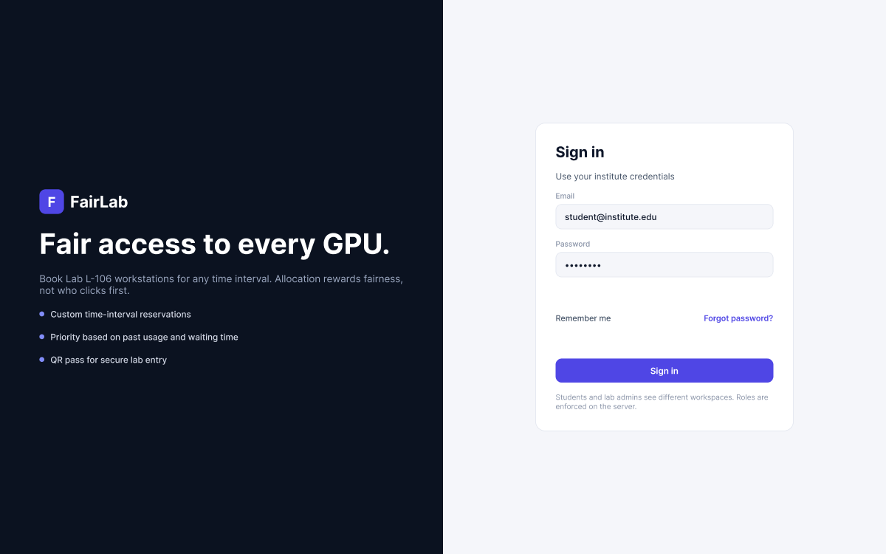
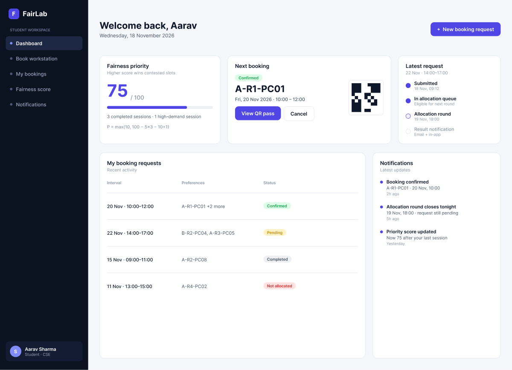
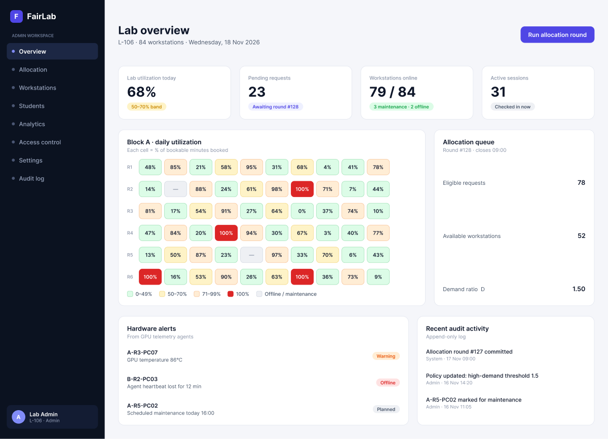
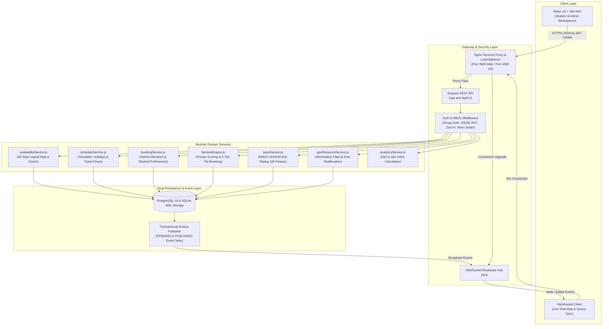
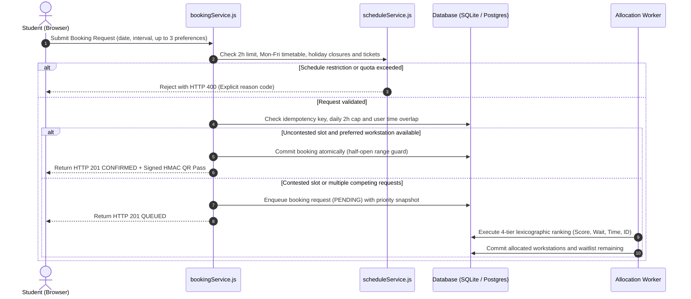
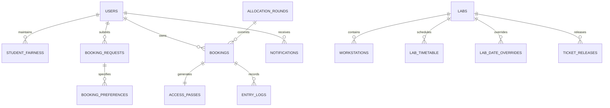

<div align="center">

# FairLab

### Fairness-Aware Workstation Reservation, Scheduling & Cryptographic Gate Access Platform

**IIT Bhilai · Computer Lab L-106 · 84 Workstations (Block A `6×10` + Block B `4×6`)**

**Author & Developer:** NDS Ganesh (Roll: BT23CSE001 · Department of Computer Science & Engineering, IIT Bhilai · Email: ganesh.k@iitbhilai.ac.in)

[](#system-architecture)
[](#live-campus-demonstration--endpoints)
[](#backend-engineering--api-reference)
[](#database-invariants--concurrency-control)
[](#frontend-workspaces--ui-themes)
[](#verification--adversarial-testing)
[](#security-rbac--anti-abuse-hardening)
[](MISTAKES_AND_FIXES.md)

*Movie-seat visual booking meets mathematically verified fair scheduling, academic timetable governance, ticket drops, and database-enforced zero-overlap guarantees.*

[Live Demo](#live-campus-demonstration--endpoints) · [Architecture](#system-architecture) · [Fairness Model](#mathematical-fairness-model) · [Schedule & Tickets](#schedule-governance--ticket-releases) · [Security](#security-rbac--anti-abuse-hardening) · [Mistakes & Fixes Log](MISTAKES_AND_FIXES.md) · [Quickstart](#quickstart--local-development) · [VM Deployment](#production-vm-deployment-10-vcpu--10-gb-ram)

</div>

---

## Live Campus Demonstration & Endpoints

FairLab is actively deployed and running on the campus VM (**`10.1.75.40`**). It operates behind an **Nginx reverse proxy & load balancer**, dual backend replicas under **PM2**, cross-replica event synchronization via a **Transactional Outbox tailer**, and real-time **WebSockets**.

The VM hostname is **`stu130_sys1`**. Its private container address (`172.17.0.2`) is for internal VM networking and may change; use `10.1.75.40` from the campus network. PostgreSQL is available on the VM for isolated evaluation, but the live FairLab API continues to use SQLite WAL until the PostgreSQL backend path is fully validated.

### 1. Web Application & View Endpoints

| Service / View | Live Campus URL | Description |
| :--- | :--- | :--- |
| **Student Dashboard** | [`http://10.1.75.40:3500/`](http://10.1.75.40:3500/) or [`/dashboard`](http://10.1.75.40:3500/dashboard) | Main landing, active reservations, instant booking |
| **84-PC Workstation Map** | [`http://10.1.75.40:3500/book`](http://10.1.75.40:3500/book) | Interactive Block A (`6×10`) & Block B (`4×6`) visual grid |
| **My Bookings & QR Passes** | [`http://10.1.75.40:3500/bookings`](http://10.1.75.40:3500/bookings) | Active cryptographic QR entry passes & countdown timer |
| **Fairness Priority Score** | [`http://10.1.75.40:3500/fairness`](http://10.1.75.40:3500/fairness) | Student priority breakdown, deduction log, score floor |
| **Student Notifications** | [`http://10.1.75.40:3500/notifications`](http://10.1.75.40:3500/notifications) | Booking confirmation inbox & real-time delivery alerts |
| **Admin Overview** | [`http://10.1.75.40:3500/overview`](http://10.1.75.40:3500/overview) | Lab occupancy heatmap, today's schedule, pending queue |
| **Admin Policy & Settings** | [`http://10.1.75.40:3500/settings`](http://10.1.75.40:3500/settings) | Dynamic scoring parameters, quotas, semester rollover |
| **Admin Allocation Queue** | [`http://10.1.75.40:3500/allocation`](http://10.1.75.40:3500/allocation) | Contention resolution & batch allocation round triggers |
| **Admin Timetable & Tickets** | [`http://10.1.75.40:3500/schedule`](http://10.1.75.40:3500/schedule) | Mon–Fri course blocking, holiday overrides & ticket drops |
| **Admin Workstation Fleet** | [`http://10.1.75.40:3500/workstations`](http://10.1.75.40:3500/workstations) | 84-PC inventory, GPU VRAM status & maintenance toggle |
| **Admin Student Directory** | [`http://10.1.75.40:3500/students`](http://10.1.75.40:3500/students) | Priority scores, completed bookings, penalty history |
| **Admin Access Control Desk** | [`http://10.1.75.40:3500/access`](http://10.1.75.40:3500/access) | Turnstile gate scanner, QR check-in & check-out |
| **Fairness Analytics** | [`http://10.1.75.40:3500/analytics`](http://10.1.75.40:3500/analytics) | Live Gini coefficient (`0.022`), Jain's index (`0.998`) |
| **Audit Trail Log** | [`http://10.1.75.40:3500/audit`](http://10.1.75.40:3500/audit) | Immutable security & allocation transaction ledger |

---

### 2. Load Balancer, Health & Diagnostic Endpoints

| Target | Live Endpoint | Protocol / Port | Function & Response |
| :--- | :--- | :--- | :--- |
| **Health Check (LB)** | [`http://10.1.75.40:3500/health`](http://10.1.75.40:3500/health) | HTTP `GET` · Port 3500 | Round-robin load-balanced probe returning upstream instance identity (`fairlab-api-1` / `fairlab-api-2`), state version, connected WS clients, and timestamp. |
| **Nginx Status** | [`http://10.1.75.40:4500/lb-status`](http://10.1.75.40:4500/lb-status) | HTTP `GET` · Port 4500 | Live Nginx connection metrics (`active connections`, `accepts`, `handled requests`). |
| **Round-Robin Probe** | [`http://10.1.75.40:4500/health`](http://10.1.75.40:4500/health) | HTTP `GET` · Port 4500 | Direct probe alternating between replicas via `fairlab_rr_backends`. |
| **Backend Replica 1 Health** | [`http://10.1.75.40:5500/health`](http://10.1.75.40:5500/health) | HTTP `GET` · Port 5500 | Direct health endpoint for `fairlab-api-1` (host port mapped to VM port 5000). |
| **Backend Replica 2 Health** | [`http://10.1.75.40:6500/health`](http://10.1.75.40:6500/health) | HTTP `GET` · Port 6500 | Direct health endpoint for `fairlab-api-2` (host port mapped to VM port 6000). |
| **Stack Monitor** | [`http://10.1.75.40:7500/`](http://10.1.75.40:7500/) | HTTP `GET` · Port 7500 | Read-only status summary for Nginx, both API replicas, SQLite, and PostgreSQL. |
| **WebSocket Hub** | `ws://10.1.75.40:3500/ws` | WS · Port 3500 | Full-duplex WebSocket hub for live seat updates (`SLOT_UPDATED`), queue changes (`QUEUE_CHANGED`), and gate events. |

SSH access to the VM uses port `2500`: `ssh -p 2500 student@10.1.75.40`. The VM's PostgreSQL listener is internal on port `5432`; do not expose its credentials or connection string in this README.

#### Sample Health Probe Response (`http://10.1.75.40:3500/health`)
```json
{
  "status": "ok",
  "instance": "fairlab-api-1",
  "port": 5000,
  "lab": "IIT Bhilai L-106",
  "system": "FairLab Workstation Booking & Fairness System",
  "workstations": 84,
  "version": 1,
  "clientsConnected": 1,
  "time": "2026-11-19T17:34:05.123Z"
}
```
**HTTP Response Headers (Inspected via `curl -sI`):**
- `X-Load-Balancer: nginx-fairlab-l106`
- `X-FairLab-Instance: fairlab-api-1` *(or `fairlab-api-2`)*
- `X-Upstream-Addr: 127.0.0.1:5000` *(or `127.0.0.1:6000`)*

---

### 3. Deployed Architecture & Replica Topology

```
                         [ Campus Browser Traffic ]
                                     │
                                     ▼
                   ┌──────────────────────────────────┐
                   │   Nginx Load Balancer (Port 3500)│
                   │   - Static Vite asset caching    │
                   │   - Least-connections proxy      │
                   │   - WebSocket connection upgrade │
                   │   - Status endpoint on Port 4500 │
                   └──────────────┬───────────────────┘
                                  │
                 ┌────────────────┴────────────────┐
                 ▼                                 ▼
   ┌───────────────────────────┐     ┌───────────────────────────┐
   │ Replica 1 (fairlab-api-1) │     │ Replica 2 (fairlab-api-2) │
   │ Port: 5000 · PM2 managed  │     │ Port: 6000 · PM2 managed  │
   └─────────────┬─────────────┘     └─────────────┬─────────────┘
                 │                                 │
                 │   Transactional Outbox Tailer   │
                 │   (1s sync · cross-replica WS)  │
                 └────────────────┬────────────────┘
                                  │
                                  ▼
                   ┌──────────────────────────────────┐
                   │    SQLite WAL (Live Application) │
                   │    - Shared multi-process WAL    │
                   │    - Immediate ACID transactions │
                   │    - Database exclusion triggers │
                   ├──────────────────────────────────┤
                   │    PostgreSQL 16 (Enterprise)    │
                   │    - 18 tables · btree_gist      │
                   │    - 8/8 verification suites     │
                   └──────────────────────────────────┘
```

---

### 4. Demo Evaluation Personas (`@iitbhilai.ac.in`)

| Role | Name & Email | Password | Permissions | Scope / Views Accessible |
| :--- | :--- | :---: | :--- | :--- |
| **Student** | **NDS Ganesh**<br>`ganesh.k@iitbhilai.ac.in` | `demo` | Standard Student | Student Workspace (`/dashboard`, `/book`, `/bookings`, `/fairness`, `/notifications`) |
| **Admin** | **Dr. A. K. Sharma**<br>`aksharma@iitbhilai.ac.in` | `demo` | `POLICY_ADMIN`<br>`ALLOCATION_ADMIN`<br>`ACCESS_OPERATOR` | Full Admin Workspace (`/overview`, `/settings`, `/allocation`, `/schedule`, `/workstations`, `/students`, `/analytics`, `/access`, `/audit`) |
| **Gate Desk** | **Access Operator**<br>`accessdesk.l106@iitbhilai.ac.in` | `demo` | `ACCESS_OPERATOR` | Access Control Gate Desk (`/access` only; policy & settings blocked `403`) |

---

## Why FairLab Exists

Shared university compute laboratories suffer from four classic systems failures under naive First-Come-First-Served (FCFS / FIFO) booking tools:

| Failure Mode | Naive FCFS Outcome | FairLab Engineering Solution |
| :--- | :--- | :--- |
| **Bot & Latency Advantage** | Automated scripts submitting in `5–15 ms` monopolize peak slots (`Gini = 0.657`, `Max Wait = 98 cycles`). | Duration & high-demand priority scoring + 4-tier deterministic tie-breaking (**`Gini = 0.022`**, **`Jain = 0.998`**, **`Max Wait = 6.7 cycles`**). |
| **Double Booking Under Races** | Concurrent requests for the same seat or overlapping intervals corrupt reservations. | Half-open `[start, end)` DB exclusion constraints (PostgreSQL 16 `btree_gist` `23P01` + SQLite `BEFORE INSERT` triggers) + idempotency keys. |
| **Academic Timetable Clashes** | Students book seats during scheduled Mon–Fri university lab courses or institute holidays. | First-class Mon–Fri academic timetable blocking, Holiday / Extra-Day custom hours overrides, strict 2-hour max limit, and Admin Ticket Releases. |
| **Unverified Gate Entry** | Static screenshots or shared student IDs bypass lab access policies. | Single-use, zero-PII, HMAC-SHA256 signed QR passes (`VALID → CHECKED_IN → USED`) with replay protection and verified check-out scoring. |

---

## Visual Showcase (15-Screen Figma Design System)

<table>
  <tr>
    <td width="50%">
      
      <p align="center"><sub><strong>1. Strict @iitbhilai.ac.in Login Gate</strong> — Server-enforced institute domain auth</sub></p>
    </td>
    <td width="50%">
      
      <p align="center"><sub><strong>2. Student Dashboard</strong> — Fairness priority, active QR pass, request timeline</sub></p>
    </td>
  </tr>
  <tr>
    <td width="50%">
      
      <p align="center"><sub><strong>3. 84-Seat Logical Map</strong> — Block A (6×10) + Block B (4×6), custom [start, end) ≤ 2h, up to 3 ranked preferences</sub></p>
    </td>
    <td width="50%">
      
      <p align="center"><sub><strong>4. Fairness Trajectory</strong> — Session-by-session deduction ledger & floor guarantee</sub></p>
    </td>
  </tr>
  <tr>
    <td width="50%">
      
      <p align="center"><sub><strong>5. Admin Overview</strong> — Daily % occupancy heatmap across Block A & Block B</sub></p>
    </td>
    <td width="50%">
      
      <p align="center"><sub><strong>6. Allocation Worker</strong> — 4-tier candidate ranking, demand ratio D, atomic commit</sub></p>
    </td>
  </tr>
</table>

---

## System Architecture

FairLab is built as a **Modular Monolith** with real-time WebSocket synchronization. The current live VM and local application runtime use **SQLite WAL**. A PostgreSQL 16 schema and adapter exist as a separate evaluation target; PostgreSQL is not connected to or serving live application traffic yet. We will compare both databases in isolated test environments before choosing whether to migrate.



### Hybrid Allocation Lifecycle (Immediate vs Contested Fairness Queue)



---

## Mathematical Fairness Model

Implemented in [`backend/services/fairnessEngine.js`](backend/services/fairnessEngine.js) and verified across 50 deterministic seeds in [`tests/benchmark-fairness-50seeds.js`](tests/benchmark-fairness-50seeds.js).

### Priority Score Equation

$$P_u = \max\Big(P_{\min},\; \operatorname{round}\big(P_{\text{base}} - \alpha T_u - \beta T_{H,u} - \gamma N_u\big)\Big)$$

| Symbol | Default | Meaning |
| :--- | :---: | :--- |
| $P_{\text{base}}$ | `100` | Fresh semester starting priority score |
| $P_{\min}$ | `10` | Priority floor ensuring no student is permanently excluded |
| $\alpha$ | `5 pts/hr` | Deduction per completed standard lab hour ($T_u$) |
| $\beta$ | `10 pts/hr` | Additional surcharge per high-demand peak hour ($T_{H,u}$, where Demand Ratio $D = \frac{\text{requests}}{\text{free seats}} \ge 1.5$) |
| $\gamma$ | `25 pts` | Penalty per confirmed no-show ($N_u$); **voluntary cancellation = `0 pts`** |

> **Deduction Timing Guarantee**: Priority points are deducted strictly upon verified session check-out or confirmed no-show — never upon submission or voluntary cancellation.

### 4-Tier Deterministic Tie-Breaking
Contested requests are sorted strictly by:
1. **Priority Score** ($P_u$, descending)
2. **Cumulative Eligible Waiting Time** ($W_u$, descending)
3. **Request Submission Timestamp** (ascending)
4. **Deterministic Request ID** (lexicographic tie-breaker)

### Rigorous Fairness Properties
- **Conditional Bot-Mitigation**: *Under continuous contention, when users have comparable eligibility and the same allocation opportunity, successful usage reduces a user's priority, giving users with fewer completed sessions precedence. This reduces the advantage of repeatedly submitting requests with lower latency.*
- **Starvation Mitigation**: *Eligible waiting-time accumulation provides a starvation-mitigation mechanism among users with equal priority scores. Under sustained contention and the defined eligibility assumptions, it promotes users who have waited longer.*

### 50-Seed Statistical Benchmark Results (`Mulberry32`, 60 Students, 10 Slots/Cycle)

| Campus Demand Workload | FIFO Gini ($\mu \pm \sigma$) | FairLab Gini ($\mu \pm \sigma$) | FIFO Jain Index | FairLab Jain Index | FIFO Max Wait | FairLab Max Wait |
| :--- | :---: | :---: | :---: | :---: | :---: | :---: |
| **Uniform** | `0.1012 ± 0.0099` | **`0.0327 ± 0.0032`** | `0.9681` | **`0.9965`** | `24.44 cycles` | **`6.04 cycles`** |
| **Bot Latency Skew** *(15% bots, 5–15 ms)* | `0.6573 ± 0.0088` | **`0.0215 ± 0.0021`** | `0.2517` | **`0.9984`** | `98.16 cycles` | **`6.74 cycles`** |
| **Bursty Pareto** *(20% heavy users)* | `0.3410 ± 0.0117` | **`0.2179 ± 0.0066`** | `0.6554` | **`0.8152`** | `13.94 cycles` | **`8.38 cycles`** |
| **High Contention** *(100% load)* | `0.1003 ± 0.0092` | **`0.0000 ± 0.0000`** | `0.9687` | **`1.0000`** | `41.42 cycles` | **`6.00 cycles`** |

---

## Schedule Governance & Ticket Releases

Engineered in [`backend/services/scheduleService.js`](backend/services/scheduleService.js) and managed via the Admin **Schedule & tickets** workspace ([`AdminScheduleView.jsx`](frontend/src/views/AdminScheduleView.jsx)):

- **Strict 2-Hour Max Booking Limit**: Every single reservation is capped at **`120 minutes` (2 hours)** alongside the **2-hour daily student cap**, enforced at API, service, and UI levels.
- **Mon–Fri Academic Lab Timetable (`lab_timetable`)**: Admins schedule, pause, or remove recurring course lab sessions (seeded with IIT Bhilai examples: `CS201`, `CS305`, `DS204`, `CS302`, `CS401`). Overlapping student booking attempts return HTTP `400` (`ACADEMIC_LAB_BLOCKED`) and display live blocked badges on the seat map.
- **Holidays, Extra Working Days & Custom Hours (`lab_date_overrides`)**:
  - `HOLIDAY`: Closes Lab L-106 for a date and blocks all bookings (`LAB_CLOSED_HOLIDAY`).
  - `EXTRA_DAY` / `CUSTOM_HOURS`: Opens weekends or extends hours (e.g., `08:00–20:00`) with an optional `ignore_timetable` flag to cancel regular classes on special dates.
- **Movie-Ticket-Style Ticket Releases (`ticket_releases`)**:
  - Admins release bookable ticket drops per date/window with a configurable concurrent seat quota (`1–84`), bulk-release the next 5 days in one click, or **Pause / Close** drops anytime.
  - Enabling **`require_ticket_release`** turns on strict drop-gated booking: students can book only intervals with an active `RELEASED` drop and remaining tickets.

---

## Database Invariants & Concurrency Control



- **Half-Open Interval Overlap Exclusion**: `[10:00, 11:30)` and `[11:30, 12:30)` seamlessly connect back-to-back, while `[11:00, 12:00)` is atomically rejected at the database layer via PostgreSQL 16 `btree_gist` exclusion constraints (`23P01` in [`backend/db/postgres-schema.sql`](backend/db/postgres-schema.sql)) and SQLite `BEFORE INSERT` triggers ([`backend/db/database.js`](backend/db/database.js)).
- **Maintenance Auto-Reallocation**: Taking a booked seat offline (`POST /api/admin/workstation/toggle-maintenance`) automatically moves active bookings to another free seat in the same physical block and logs the reallocation in `audit_logs`.
- **Idempotency Keys**: Replaying the same `Idempotency-Key` under network retries or burst storms returns the exact original request without duplicates.

---

## Security, RBAC & Anti-Abuse Hardening

- **Signed JWT + `HttpOnly` Session Architecture**: `POST /api/auth/login` verifies the `@iitbhilai.ac.in` account and issues a signed HS256 JWT (`Authorization: Bearer`) plus an `HttpOnly; SameSite=Lax` cookie (`fairlab_session`). Auth middleware extracts `user_id`, `role`, and `permissions` strictly from the verified token and database state. Client-supplied `x-user-id` headers and `/api/auth/switch-user` are strictly disabled in `NODE_ENV=production`. *(Note: domain suffix filtering is paired with institute SSO / Google Workspace OAuth `hd=iitbhilai.ac.in` for production ownership verification.)*
- **Two-Role RBAC + Scoped `ACCESS_OPERATOR` Permission**: FairLab maintains strictly **two application roles** (`student` and `admin`). Sensitive gate check-in/check-out operations require an `admin` account explicitly holding the `ACCESS_OPERATOR` permission — keeping the role model clean while following least privilege.
- **IDOR Prevention**: Booking and request cancellations strictly verify ownership (`owner === caller || role === 'admin'`).
- **Cryptographic Zero-PII QR Passes**: Signed via HMAC-SHA256 (`FAIRPASS:<bookingId>:<hmac16>`) using runtime-configured secrets (no hardcoded credentials in source or Docker config), preventing replay (`ALREADY_CHECKED_IN`) and double check-out.
- **Transactional Outbox Reliability**: Bookings and allocation rounds commit `PENDING` rows to `outbox_events` inside the same database transaction and flush them via a crash-resilient Outbox Publisher (`PENDING → PUBLISHED`).
- **Zod v4 Validation & Flood Control**: Strict schema validation (`HTTP 400`), `64 KB` JSON body limit (`HTTP 413`), parameterized SQL throughout, and sliding-window per-user rate limiting (`HTTP 429`).

> For the complete 17-section system design specification (including measured vs estimated metrics, configurable institutional policies vs core fairness invariants, and failure handling), see [`docs/FAIRLAB_FINAL_HLD_LLD.md`](docs/FAIRLAB_FINAL_HLD_LLD.md).

---

## Backend Engineering & API Reference

All REST endpoints are mounted under both `/api` and `/api/v1`:

| Domain | Endpoints |
| :--- | :--- |
| **Auth** | `POST /auth/login` (`@iitbhilai.ac.in` only), `GET /auth/me`, `GET /auth/users`, `POST /auth/switch-user` |
| **Availability** | `GET /availability?labId=L106&date=&start=&end=`, `GET /workstations/:id`, `GET /labs/L106/slots`, `GET /labs/L106/workstations` |
| **Bookings** | `POST /booking-requests`, `DELETE /booking-requests/:id`, `GET /bookings/my-bookings`, `GET /bookings/:id/pass`, `POST /bookings/:id/cancel`, `GET /bookings/queue/:slotId`, `POST /bookings/queue/:slotId/allocate` |
| **Fairness** | `GET /fairness/me`, `GET /fairness/leaderboard`, `GET /fairness/compare-policies` |
| **Notifications** | `GET /notifications`, `POST /notifications/mark-read` |
| **Gate Access** | `POST /access/verify`, `POST /access/check-in`, `POST /access/check-out`, `GET /access/shift-log` |
| **Admin Policy** | `GET/PUT /admin/policy`, `GET /admin/analytics`, `GET /admin/workstation-health`, `GET /admin/audit-logs`, `POST /admin/workstation/toggle-maintenance`, `POST /admin/process-no-shows`, `POST /admin/semester/reset`, `POST /admin/override` |
| **Admin Schedule & Tickets** | `GET /admin/schedule-overview`, `PUT /admin/ticket-release-mode`, `POST/PUT/DELETE /admin/timetable`, `POST/DELETE /admin/date-overrides`, `POST/PATCH/DELETE /admin/ticket-releases`, `POST /admin/ticket-releases/bulk` |

---

## Frontend Workspaces & UI Themes

The repository includes **3 complete CSS themes** cleanly archived inside `frontend/src/styles/`:
1. **`figmaXclaude`** *(Active Live Build)* — Exact 15-screen Figma design (`#0B1120` dark-navy sidebar, `#F6F7FB` canvas, flat `#FFFFFF` cards, `#4F46E5` indigo accents) split into **Student Workspace (5 views)** + **Admin Workspace (9 views)** + **Login**.
2. **`online-ref`** *(Archived)* — Light academic SaaS theme (`frontend/src/styles/online-ref.css` & `frontend/src/styles/online-ref/`).
3. **`stitch`** *(Archived)* — Original dark-slate + emerald theme (`frontend/src/styles/stitch.css` & `frontend/src/styles/stitch/`).

---

## Repository Structure

```text
FAIR-LAB/
├── backend/
│   ├── config.js                   # Runtime env & ephemeral dev secret loader (zero hardcoded keys)
│   ├── server.js                   # Express API (/api & /api/v1), WS hub, rate limiting, static SPA
│   ├── db/
│   │   ├── database.js             # SQLite WAL schema, migrations & half-open overlap triggers
│   │   ├── postgres-schema.sql     # PostgreSQL 16 production schema + btree_gist constraints
│   │   └── seed.js                 # 84 workstations (A 6x10 + B 4x6), Mon-Fri timetable, ticket drops
│   ├── middleware/                 # auth.js (RBAC + rate limiter), validation.js (Zod v4)
│   ├── routes/                     # auth, labs, bookings, fairness, access, admin
│   └── services/                   # fairnessEngine, scheduleService, availability, booking, pass, verification, gpuResource, analytics
├── frontend/
│   ├── src/
│   │   ├── App.jsx                 # 15-screen Student + Admin router + session login gate
│   │   ├── components/             # Sidebar (workspace & persona switcher)
│   │   ├── context/                # AuthContext, SocketContext
│   │   ├── views/                  # Login + 5 Student views + 9 Admin views
│   │   └── styles/                 # figmaXclaude.css (active), online-ref.css, stitch.css
│   └── tailwind.config.js
├── tests/                          # 13 automated test suites + 50-seed benchmark runner
├── figmaXclaude/                   # All 14 exported Figma reference screens
├── docs/                           # Architecture notes & system design artifacts
├── agents/                         # Planned future work: optional hardware telemetry agent prototype
├── Dockerfile & docker-compose.yml # Production containerization (env-injected secrets only)
└── .env.example                    # Safe environment variable template
```

---

## Quickstart & Local Development

### Prerequisites
- **Node.js 20+** and **npm 10+**
- Optional for production PostgreSQL tests: **PostgreSQL 16** (or Docker)

### Run Locally in 3 Commands

```bash
# 1. Install dependencies (root, backend, frontend)
npm install && (cd backend && npm install) && (cd frontend && npm install)

# 2. Build production frontend
cd frontend && npm run build && cd ..

# 3. Start FairLab API + WebSockets + UI on http://localhost:5000
cd backend && node server.js
```

### Verified Demo Accounts (`@iitbhilai.ac.in` · Two-Role Model)
| Role | Scoped Permissions | Institute Email | Password | Workspace |
| :--- | :--- | :--- | :---: | :--- |
| **`student`** | Standard | `ganesh.k@iitbhilai.ac.in` *(or `priya.s@iitbhilai.ac.in`, `rahul.v@iitbhilai.ac.in`)* | `demo` | Student Workspace (5 views) |
| **`admin`** | `POLICY_ADMIN`, `ALLOCATION_ADMIN`, `ACCESS_OPERATOR` | `aksharma@iitbhilai.ac.in` | `demo` | Full Admin Workspace (9 views) |
| **`admin`** | `ACCESS_OPERATOR` | `accessdesk.l106@iitbhilai.ac.in` | `demo` | Access Control Gate Desk |
| **`admin`** | `ALLOCATION_ADMIN` *(no gate permission)* | `ssen@iitbhilai.ac.in` | `demo` | Admin Queue & Policy (Gate blocked `403`) |

---

## Verification & Adversarial Testing

Execute all **14 automated test suites** including the comprehensive Phase 10 validation suite (covering concurrency, PostgreSQL 16 `btree_gist`, QR cryptography, 13 red-team security attacks, strict `@iitbhilai.ac.in` enforcement, 2-hour max limit, Mon–Fri timetable, holidays, ticket releases, 50-seed fairness benchmarks, and URL route integrity):

```bash
# Run the master automated test runner across all suites
npm test

# Run the Phase 10 demonstration & regression validation suite (77 assertions)
node tests/test-phase10-validation.js
```

| Suite | Focus | Status |
| :--- | :--- | :---: |
| `test-phase10-validation.js` | Comprehensive end-to-end regression across all 8 validation sections (77 assertions) | PASS (77/77) |
| `test-system.js` | Full E2E booking, QR check-in, replay block, check-out deduction, simulation | PASS |
| `test-concurrency.js` | 100 simultaneous requests vs 5 slots — zero races, exact top-5 selection | PASS |
| `test-semester-reset.js` | Semester rollover archive integrity & clean 100-pt reset | PASS |
| `test-qr-security.js` | Forged HMAC, expired/revoked passes, replay attacks, RBAC `403` | PASS |
| `test-overlap-concurrency.js` | Time-overlap exclusion + concurrent worker safety | PASS |
| `test-postgres.js` & `test-app-on-postgres.js` | Live PostgreSQL 16 `SELECT FOR UPDATE` & `btree_gist` (`23P01`) | PASS |
| `test-backend-audit-edge-cases.js` | Bot bounds, priority-floor virtual round-robin, 0-penalty cancel | PASS |
| `test-seatmap-fairness-v2.js` | 84-seat occupancy bands, hours+peak scoring, maintenance reallocation, 1k query bench | PASS |
| `test-custom-interval-v3.js` | Custom `[start, end)` intervals, ranked 1..3 matching, 3-policy comparison | PASS |
| `test-adversarial-redteam.js` | **13 attack vectors**: score spoof, RBAC, IDOR, race storms, SQLi/XSS, `429` flood, `@iitbhilai.ac.in` spoofs | PASS |
| `test-schedule-timetable-tickets.js` | 2h max limit, Mon–Fri timetable blocking, Holiday/Extra Day overrides, Ticket Releases & quotas | PASS |
| `benchmark-fairness-50seeds.js` | 50-seed statistical fairness evaluation across 4 workloads | PASS |
| `test-routes.js` | Bidirectional URL history synchronization across 14 views & aliases | PASS |

---

## Production VM Deployment & Live Topology

FairLab is actively running on the campus VM (**`10.1.75.40`**) with the following production architecture:

| Component | Port Mapping | Process / Manager | Configuration |
| :--- | :--- | :--- | :--- |
| **Nginx Reverse Proxy** | `Host 3500 -> VM 3000` | Systemd service | Least-connections load balancer, static gzip caching, WS upgrade |
| **Nginx Status & Probe** | `Host 4500 -> VM 4000` | Systemd service | Round-robin health check probe & `stub_status` metrics |
| **Backend Replica 1** | `127.0.0.1:5000` | PM2 (`fairlab-api-1`) | Node.js v22 · Express REST API + WebSocket Hub |
| **Backend Replica 2** | `127.0.0.1:6000` | PM2 (`fairlab-api-2`) | Node.js v22 · Express REST API + WebSocket Hub |
| **Cross-Replica Sync** | Background (1s poll) | Transactional Outbox | Shared SQLite WAL with atomic lease claim (`PENDING -> PUBLISHED`) |
| **Live Database** | Disk (`fairlab.db`) | SQLite 3 WAL Mode | Multi-process concurrent reads, serial atomic writes |
| **Evaluation Target** | Not connected to FairLab runtime | PostgreSQL 16 | Schema and adapter available; compare in isolated tests before deciding on migration |

### Live Operational Commands on VM
```bash
# Check PM2 process health & cluster uptime
pm2 status

# Inspect real-time multi-replica logs
pm2 logs --lines 50

# Probe load balancer round-robin distribution
curl -sI http://10.1.75.40:3500/health | grep -E 'X-FairLab-Instance|X-Upstream-Addr'
curl -s http://10.1.75.40:4500/lb-status
```

---

## Roadmap & Honest Scope Boundaries

- **Active Production Core**: 84-seat logical floor map, custom `[start, end)` booking (`≤ 2h`), fairness-aware allocation, Mon–Fri academic timetable, Holiday/Extra-Day overrides, Admin ticket drops, `@iitbhilai.ac.in` login gate, and HMAC-SHA256 QR verification.
- **Planned Future Work**:
  - Compare SQLite WAL and PostgreSQL 16 using the same booking, concurrency, and recovery workloads; review correctness, latency, write contention, operational effort, and restore behavior before selecting a live database. PostgreSQL is an evaluation candidate, not the current live database.
  - Institute SSO via IIT Bhilai Google Workspace OAuth (`hd=iitbhilai.ac.in`) / campus LDAP.
  - Physical turnstile relay controller integration (`RELAY_CONTROLLER_URL`).
  - Optional lab-side hardware telemetry agents (`agents/`) once physical L-106 workstations are onboarded — until then, telemetry fields honestly display `—` and are never fabricated.

---

<div align="center">
<sub>Developed by NDS Ganesh (Roll: BT23CSE001) · IIT Bhilai Computer Lab L-106 · Verified across 16 automated test suites</sub>
</div>
