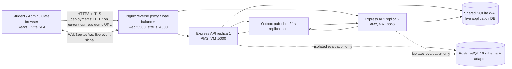

# FairLab End-to-End Architecture

## High-level diagram

**Important database distinction:** the current deployed application uses SQLite WAL as its live DB. PostgreSQL schema/adapter work is an isolated evaluation target and is not the live request path. Do not describe PostgreSQL as serving live bookings.

## Request and booking flow

1. React renders the workstation map. It requests availability through `GET /api/v1/availability` with lab, date, start, and end.
2. Nginx forwards the request to one Express replica. The backend reads authoritative reservation/workstation/timetable state from the shared SQLite DB.
3. The browser displays availability. The selected seat and requested interval are user intent only; the server validates again on booking submission.
4. A booking mutation uses the HTTP API (`POST /api/v1/bookings/request` in the current route family), validates authenticated user/role and request shape, then the service applies business rules and writes transactionally. The precise endpoint payload should be confirmed in the API docs for the current UI action.
5. Database constraints/triggers and transaction logic protect invariants such as no overlapping active reservations. Idempotency keys can prevent duplicate processing on retried booking requests.
6. A durable outbox event is committed with relevant state changes. The publisher/tailer forwards events across both backend replicas.
7. Each replica sends WebSocket messages to its connected browsers. A receiving booking map subscribes to event types and refetches availability over HTTP, then React updates the seat display.

## Why HTTP and WebSockets are both present

- **HTTP** is used for page assets, initial availability, account/profile, booking submission, cancellation, and query responses. It is request/response and easy to retry, authorize, validate, and inspect.
- **WebSocket** keeps a long-lived bidirectional channel for low-latency notifications that something changed. It avoids constant polling for every small update.
- The WebSocket message is a hint/event, not the authoritative booking record. The UI refetches via HTTP; the DB transaction decides whether a booking succeeds.
- A reconnect does not itself guarantee replay of every event. The screen must be able to refetch current state after reconnect or on focus; verify behavior in implementation before claiming missed-event recovery.

## Why the transactional outbox exists with WebSockets

The database commit and network send cannot normally be one atomic action. If the app commits a booking and crashes before sending the socket event, another replica/client may not hear about it. The outbox stores an event in the same DB transaction as the mutation. A publisher retries pending rows. Delivery can be at least once, so consumers deduplicate by `eventId`; duplicates must be harmless. Persistent user notifications are still stored separately for history/unread state—socket transport is not an inbox.

## Security and correctness boundaries

- The browser is untrusted; server-side authentication, authorization, validation, and database invariants are required.
- A green seat can become unavailable after the last refresh. The server must reject conflicts safely and show a useful error/refresh.
- Socket delivery improves freshness but cannot replace validation at booking time.
- The app uses a shared SQLite WAL database for two processes. WAL permits concurrent readers with a writer; it does not create multi-writer horizontal database scaling. PostgreSQL would be a future alternative requiring end-to-end service compatibility and operational validation.
- The current campus endpoint in the README is `http://...`; do not call it HTTPS unless a TLS-terminating URL/certificate is actually configured. WebSocket scheme is `ws://` on HTTP and `wss://` when served over HTTPS.

