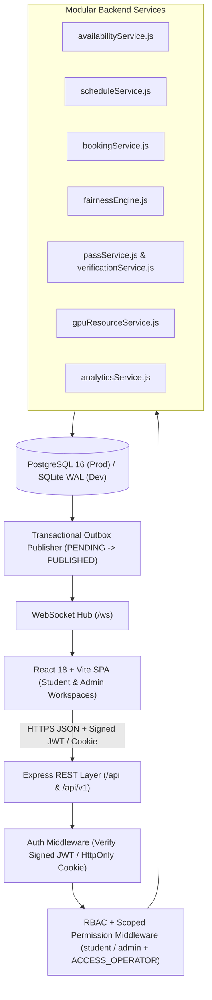
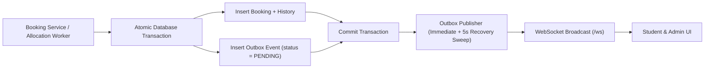
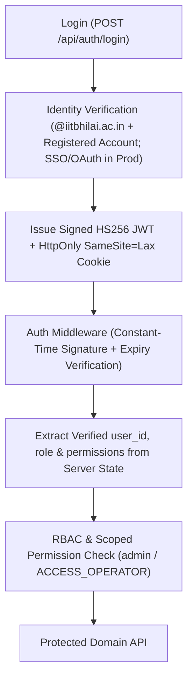

# FairLab — Final High-Level & Low-Level System Design Document (HLD + LLD)

> **Project**: FairLab — Fairness-Aware Laboratory Workstation Reservation & Resource Management System  
> **Target Facility**: IIT Bhilai · Computer Lab L-106 (**84 Workstations**: Block A `6×10` + Block B `4×6`)  
> **Architecture**: Modular Monolith (Node.js + Express + WebSockets + PostgreSQL 16 / SQLite WAL) + React/Vite SPA  
> **Document Scope**: Internally consistent HLD + LLD separating currently implemented software guarantees from planned physical hardware integrations.

---

## 1. Executive Summary

FairLab is a fairness-aware workstation reservation, scheduling, and gate-access platform built for IIT Bhilai Computer Lab L-106. It combines a visual seat-map booking experience across all 84 workstations with a backend-enforced fairness allocation engine, configurable institutional schedule rules (Mon–Fri academic lab classes, holidays, extra working days, and ticket drops), database-level overlap protection, and single-use HMAC-SHA256 QR verification passes.

The core architectural principle is strict server authority: **the frontend presents live availability and collects user preferences, while the backend and database own authentication, schedule policy enforcement, fairness ranking, overlap prevention, and allocation decisions.**

---

## 2. Problem Statement and Objectives

### 2.1 Limitations of First-Come-First-Served (FCFS / FIFO) Lab Booking
1. **Latency & Automation Bias**: Students using scripts or low-latency refreshes repeatedly claim scarce peak slots ahead of typical web users.
2. **Double Booking & Race Conditions**: Application-only availability checks fail under concurrent bursts for overlapping custom intervals.
3. **Uncoordinated Academic Classes & Holidays**: Static grids fail to block regular Mon–Fri course lab sessions or reflect holiday closures and extra weekend working days.
4. **Weak Entry Verification**: Unverified room access allows no-show seat hoarding and unaccountable usage.

### 2.2 Primary Objectives
- Provide real-time visual availability across 84 permanent workstation IDs (`A-R1-PC01`..`A-R6-PC10`, `B-R1-PC01`..`B-R4-PC06`).
- Enforce zero overlapping workstation or student reservations at the database layer using half-open `[start, end)` intervals.
- Mitigate repeated hoarding under contention via duration- and high-demand-weighted fairness scoring with waiting-time tie-breaking.
- Separate implemented software capabilities cleanly from planned physical hardware integrations (door relays and optional GPU telemetry agents).

---

## 3. Functional and Non-Functional Requirements

### 3.1 Functional Requirements
- **FR1 — Verified Institute Access**: Restrict login to `@iitbhilai.ac.in` accounts with signed JWT + `HttpOnly` session cookies (and institute SSO/OAuth planned for production identity verification).
- **FR2 — Custom Interval Reservation**: Support arbitrary half-open `[start, end)` intervals subject to configurable institutional bounds (default: `30 min` min, `120 min` max per booking, `2.0 hrs` daily quota) and up to `3` ranked seat preferences.
- **FR3 — Hybrid Immediate & Contested Allocation**: Confirm uncontested intervals atomically when safe; queue contested intervals for fairness-ranked allocation rounds.
- **FR4 — Institutional Schedule Governance**: Support Mon–Fri academic lab timetable blocks, date overrides (Holidays, Extra Days, Custom Hours), and admin-controlled Ticket Releases.
- **FR5 — Gate Verification & Auditability**: Issue zero-PII HMAC-SHA256 QR passes (`VALID → CHECKED_IN → USED`), record check-in/out events, and maintain an append-only audit log.

### 3.2 Non-Functional Requirements
- **Consistency**: ACID transactions with database-enforced overlap constraints (`btree_gist` exclusion constraints in PostgreSQL 16; `BEFORE INSERT` triggers in SQLite WAL).
- **Idempotency**: Duplicate client retries with identical `Idempotency-Key` produce at most one logical request.
- **Event Reliability**: Transactional Outbox (`outbox_events`: `PENDING → PUBLISHED`) prevents silent loss of real-time UI notifications on crash.
- **Security**: Server-derived identity from signed JWT/session cookies, strict two-role RBAC + scoped `ACCESS_OPERATOR` permission, Zod v4 schema validation, and per-user sliding-window rate limiting.

---

## 4. High-Level Architecture

FairLab adopts a **Modular Monolith** to keep deployment simple on a single campus VM while maintaining clean internal module boundaries.

---

## 5. User Roles and Permissions

FairLab uses a clean **two-role application model** with **scoped operational permissions** stored on each account:

| Role | Scoped Permissions | Authorized Capabilities |
| :--- | :--- | :--- |
| **`student`** | `[]` (Standard) | Browse 84-seat map, submit/withdraw booking requests, cancel own bookings (0 penalty), view own fairness score, download own QR pass, read own notifications |
| **`admin`** | `POLICY_ADMIN` | Edit fairness weights, booking duration caps, daily quotas, lab hours, no-show sweeps, semester reset |
| **`admin`** | `ALLOCATION_ADMIN` | Inspect queues, commit allocation rounds, manage Mon–Fri timetable, holidays/extra days, ticket releases, workstation maintenance, view analytics & audit log |
| **`admin`** | **`ACCESS_OPERATOR`** | Perform physical lab gate QR check-in and check-out operations (`POST /api/access/check-in`, `POST /api/access/check-out`) |

> **Why `ACCESS_OPERATOR` is a permission rather than a third role**: Keeping two application roles (`student` and `admin`) simplifies identity and workspace routing while preventing every administrator (for example, a faculty coordinator with only `ALLOCATION_ADMIN`) from performing sensitive gate check-in/out actions unless explicitly granted `ACCESS_OPERATOR`.

---

## 6. Workstation Inventory and Booking Model

### 6.1 Physical-to-Logical Inventory (84 Systems)
- **Block A**: `6 rows × 10 columns = 60 workstations` (`A-R1-PC01` through `A-R6-PC10`)
- **Block B**: `4 rows × 6 columns = 24 workstations` (`B-R1-PC01` through `B-R4-PC06`)
- Workstations are always identified by permanent IDs rather than mutable array indices.

### 6.2 Hybrid Booking Decision Algorithm (Exact Contention Criteria)
FairLab supports both **Immediate Booking** (when uncontested) and **Fairness Queue Allocation** (when contested). Both paths execute inside atomic database transactions governed by the exact same overlap constraints:

1. Request arrives (`date`, `[startTime, endTime)`, up to `3` ranked workstation preferences, optional `Idempotency-Key`).
2. `scheduleService.js` validates institutional schedule policies (holiday closure, effective open/close hours, single-booking duration cap, Mon–Fri academic timetable conflicts, and active ticket release quotas).
3. `bookingService.js` verifies daily quota, user overlap, and idempotency, recording the request with its locked priority snapshot.
4. **Inside the same atomic transaction (`immediateTx`)**, the backend checks contention:
   - Is an allocation round currently `RUNNING` for `bookingDate`?
   - Does any other eligible `QUEUED` request overlap `[startTime, endTime)`?
   - Is at least one eligible workstation free without violating the half-open overlap constraint?
5. If **uncontested and free**, the booking commits immediately (`allocation_mode = 'IMMEDIATE'`), inserts a `PENDING` outbox event, and generates a signed QR pass post-commit.
6. Otherwise, the request remains in `QUEUED` state (`allocation_mode = 'SCHEDULED'`) for the fairness allocation worker. Clients can never force `IMMEDIATE` mode when contention exists.

### 6.3 Core Booking Invariants vs Configurable Institutional Policies
| Constraint Category | Rule | Default | Scope |
| :--- | :--- | :---: | :--- |
| **Core Integrity** | Non-overlapping intervals `[start, end)` per seat & per user | Always ON | Hard DB constraint |
| **Core Integrity** | Max concurrent active bookings per overlapping window | `1` | Hard DB constraint |
| **Institutional Policy** | Minimum single-booking duration | `30 min` | Configurable (`policy_config`) |
| **Institutional Policy** | Maximum single-booking duration | `120 min` (2h) | Configurable (`policy_config`) |
| **Institutional Policy** | Maximum total booked duration per student per day | `2.0 hrs` | Configurable (`policy_config`) |
| **Institutional Policy** | Mon–Fri academic timetable, holidays/extra days, ticket drops | Active | Configurable (`lab_timetable`, `lab_date_overrides`, `ticket_releases`) |

---

## 7. Fairness Allocation Algorithm

### 7.1 Priority Score Formula
$$P_u = \max\Big(P_{\min},\; \operatorname{round}\big(P_{\text{base}} - \alpha T_u - \beta T_{H,u} - \gamma N_u\big)\Big)$$

Default weights: $P_{\text{base}} = 100$, $P_{\min} = 10$, $\alpha = 5\text{ pts/hr}$ (total completed hours $T_u$), $\beta = 10\text{ pts/hr}$ (high-demand hours $T_{H,u}$ where demand ratio $D = \frac{\text{eligible requests}}{\text{free seats}} \ge 1.5$), $\gamma = 25\text{ pts}$ per confirmed no-show ($N_u$). Voluntary cancellation incurs $0$ penalty points. Deductions occur strictly on verified check-out or confirmed no-show.

### 7.2 Four-Tier Deterministic Ranking
1. **Priority Score** ($P_u$, descending)
2. **Cumulative Eligible Waiting Time** ($W_u$, descending)
3. **Request Submission Timestamp** (ascending)
4. **Request ID** (deterministic lexicographic tie-breaker)

### 7.3 Rigorous Fairness Properties
- **Conditional Bot-Advantage Mitigation**: *Under continuous contention, when users have comparable eligibility and the same allocation opportunity, successful usage reduces a user's priority, giving users with fewer completed sessions precedence. This reduces the advantage of repeatedly submitting requests with lower latency.*
- **Starvation-Mitigation Property**: *Eligible waiting-time accumulation provides a starvation-mitigation mechanism among users with equal priority scores. Under sustained contention and the defined eligibility assumptions, it promotes users who have waited longer.*

---

## 8. Backend Modules and API Design

| Module | File | Responsibility |
| :--- | :--- | :--- |
| **Auth & RBAC** | [auth.js](file:///home/ganesh/Desktop/csd/project/backend/middleware/auth.js), [auth.js (route)](file:///home/ganesh/Desktop/csd/project/backend/routes/auth.js) | HS256 JWT signing/verification, `HttpOnly` cookie sessions, `@iitbhilai.ac.in` filter, RBAC & `ACCESS_OPERATOR` enforcement |
| **Validation** | [validation.js](file:///home/ganesh/Desktop/csd/project/backend/middleware/validation.js) | Zod v4 request validation returning structured HTTP `400` errors |
| **Availability** | [availabilityService.js](file:///home/ganesh/Desktop/csd/project/backend/services/availabilityService.js) | 84-seat interval availability, daily occupancy heatmaps, write-invalidated cache + `stateVersion` |
| **Schedule & Tickets** | [scheduleService.js](file:///home/ganesh/Desktop/csd/project/backend/services/scheduleService.js) | 2h limit, Mon–Fri timetable blocking, holidays/extra days, ticket release drops & concurrent quota checks |
| **Booking & Outbox** | [bookingService.js](file:///home/ganesh/Desktop/csd/project/backend/services/bookingService.js) | Atomic hybrid booking, batch allocation worker, no-show sweep, `publishPendingOutboxEvents` |
| **Fairness** | [fairnessEngine.js](file:///home/ganesh/Desktop/csd/project/backend/services/fairnessEngine.js) | Priority formula, demand classification, 4-tier sort, daily quota, leaderboard, semester reset |
| **Access & Passes** | [passService.js](file:///home/ganesh/Desktop/csd/project/backend/services/passService.js), [verificationService.js](file:///home/ganesh/Desktop/csd/project/backend/services/verificationService.js) | HMAC-SHA256 zero-PII QR generation, strict check-in/check-out state machine |
| **Inventory** | [gpuResourceService.js](file:///home/ganesh/Desktop/csd/project/backend/services/gpuResourceService.js) | Maintenance state management + automatic same-block booking reallocation |
| **Analytics** | [analyticsService.js](file:///home/ganesh/Desktop/csd/project/backend/services/analyticsService.js) | Mulberry32 deterministic 3-policy fairness simulator |

All REST endpoints are versioned under `/api/v1` (with `/api` alias) across `/auth`, `/availability`, `/labs`, `/booking-requests`, `/bookings`, `/fairness`, `/notifications`, `/access`, and `/admin`.

---

## 9. Database Design and Constraints

- **Primary Production Schema**: [postgres-schema.sql](file:///home/ganesh/Desktop/csd/project/backend/db/postgres-schema.sql) (PostgreSQL 16 + `btree_gist` exclusion constraints `exclude_overlapping_machine_bookings` & `exclude_overlapping_user_bookings` raising SQLSTATE `23P01` + `SELECT ... FOR UPDATE`).
- **Embedded Dev/Test Schema**: [database.js](file:///home/ganesh/Desktop/csd/project/backend/db/database.js) (SQLite WAL + `BEFORE INSERT` half-open overlap triggers mirroring PostgreSQL exclusion guarantees).
- **Core Tables**: `users` (with `permissions`), `semesters`, `student_fairness`, `labs`, `workstations`, `lab_slots`, `lab_timetable`, `lab_date_overrides`, `ticket_releases`, `booking_requests`, `booking_preferences`, `allocation_rounds`, `bookings`, `waitlist_entries`, `allocation_history`, `access_passes`, `entry_logs`, `notifications`, `outbox_events`, `audit_logs`, `policy_config`.

---

## 10. Real-Time Communication & Transactional Outbox

To prevent silent notification loss when the process crashes between a database commit and a WebSocket broadcast, FairLab implements the **Transactional Outbox Pattern**:

If the server restarts or a broadcast fails, unacknowledged `PENDING` rows remain safely persisted in `outbox_events` and are automatically re-published and marked `PUBLISHED` on the next publisher sweep.

---

## 11. Hardware Telemetry Separation and Access Control

- **Implemented Software Access Control**: Zero-PII HMAC-SHA256 QR tokens (`FAIRPASS:<bookingId>:<hmac16>`), state-enforced check-in (`VALID → CHECKED_IN`) and check-out (`CHECKED_IN → USED`), replay rejection (`ALREADY_CHECKED_IN`), and `ACCESS_OPERATOR` RBAC enforcement.
- **Planned Hardware Integrations (Not Active in Software Core)**:
  - Physical turnstile door relay webhook (`RELAY_CONTROLLER_URL`) is decoupled from authorization logic; gate decisions are persisted even without hardware attached.
  - Automated workstation GPU telemetry agents (`agents/`) are excluded from live availability calculations and UI meters; telemetry fields display `—` until physical L-106 agents are onboarded.

---

## 12. Security Architecture

- **Zero Client-Supplied Trust in Production**: In `NODE_ENV=production`, `x-user-id` headers and `/api/auth/switch-user` are strictly ignored/rejected (`401`/`403`). Dev persona switching is restricted exclusively to local non-production mode.
- **Email Domain vs Ownership Proof**: Checking the `@iitbhilai.ac.in` suffix prevents non-institute accounts from entering the login path, but does not by itself prove mailbox ownership; production rollout replaces password/demo lookup with IIT Bhilai Google Workspace OAuth (`hd=iitbhilai.ac.in`) or institutional LDAP/SSO.
- **Zero Hardcoded Secrets**: [config.js](file:///home/ganesh/Desktop/csd/project/backend/config.js) generates ephemeral dev secrets via `crypto.randomBytes(32)` and fails fast in production if `JWT_SECRET` or `HMAC_SECRET` are missing.

---

## 13. Failure Handling and Concurrency

- **Concurrent Seat Races**: Serialized inside SQLite/PostgreSQL transactions with half-open overlap constraints (`23P01`) preventing double-assignment even under 30-student overlapping races.
- **Client Retry Storms**: Handled via `Idempotency-Key` deduplication.
- **Pass Generation Failure**: Decoupled from booking commit; a booking stays confirmed even if QR rendering retries asynchronously.
- **Workstation Failure / Maintenance**: Marking a booked seat offline atomically reallocates active bookings to another free seat in the same block and logs an audit entry.
- **Transactional Outbox Recovery & At-Least-Once Idempotency**: Events committed as `PENDING` inside booking/allocation transactions are swept immediately on server startup and every 5 seconds. Every outbox broadcast carries its deterministic `eventId`, and the frontend WebSocket consumer ([SocketContext.jsx](file:///home/ganesh/Desktop/csd/project/frontend/src/context/SocketContext.jsx)) deduplicates by `eventId` (bounded 500-entry set) so a crash between broadcast and `PUBLISHED` update never causes duplicate consumer side effects.
- **Graceful Shutdown**: `SIGTERM`/`SIGINT` handlers stop the outbox timer, drain HTTP connections, and close database handles cleanly.

---

## 14. Frontend UI/UX

- Built in React 18 + Vite + Tailwind CSS following the 14-screen Figma specification (`figmaXclaude`, `#0B1120` sidebar, `#F6F7FB` canvas, `#FFFFFF` cards, `#4F46E5` primary accent) plus a dedicated **Schedule & tickets** admin panel (`15` live screens total).
- Student Workspace (5 views): Dashboard, Book Workstation (84-seat map + live schedule/timetable/ticket strip), My Bookings & QR Pass, Fairness Score, Notifications.
- Admin Workspace (9 views): Overview (daily `%` heatmap), Allocation Round, Schedule & Tickets, Workstations, Students, Analytics, Access Control, Settings, Audit Log.
- Three complete CSS themes (`figmaXclaude`, `online-ref`, `stitch`) are cleanly preserved under `frontend/src/styles/`.

---

## 15. Testing and Fairness Evaluation

### Measured Test Results vs Capacity Estimates

| Metric / Claim | Classification | Evidence / Basis |
| :--- | :--- | :--- |
| **14 / 14 automated test suites passing** | **Measured test result** | Executed locally via `npm test` ([run-all-tests.js](file:///home/ganesh/Desktop/csd/project/tests/run-all-tests.js)) |
| **Phase 10 validation (`76 / 76` assertions)** | **Measured test result** | Executed in [test-phase10-validation.js](file:///home/ganesh/Desktop/csd/project/tests/test-phase10-validation.js) — clean DB boot, full student + gate journey, 6-student simultaneous `Promise.all` race & anti-bypass fairness, maintenance reallocation, `NODE_ENV=production` JWT/Secure-cookie/`x-user-id` blocking, and hard `SIGKILL` server-restart outbox recovery + consumer deduplication |
| **100 concurrent requests vs 5 slots** | **Tested concurrency scenario** | Executed in [test-concurrency.js](file:///home/ganesh/Desktop/csd/project/tests/test-concurrency.js) (`~150–230 ms`, 0 duplicates) |
| **PostgreSQL 16 `btree_gist` exclusion (`23P01`)** | **Tested live PostgreSQL result** | Executed against PostgreSQL 16 container ([test-app-on-postgres.js](file:///home/ganesh/Desktop/csd/project/tests/test-app-on-postgres.js)) |
| **14 red-team security & auth vectors** | **Measured test result** | Executed in [test-adversarial-redteam.js](file:///home/ganesh/Desktop/csd/project/tests/test-adversarial-redteam.js) (JWT verify/tamper, `ACCESS_OPERATOR` `403`, `@iitbhilai.ac.in` spoofs, RBAC, IDOR, SQLi/XSS, `429`) |
| **50-seed fairness benchmark** | **Deterministic simulation result** | Mulberry32 `Seed 1337` ([benchmark-fairness-50seeds.js](file:///home/ganesh/Desktop/csd/project/tests/benchmark-fairness-50seeds.js)): Bot-skew Gini `0.657 → 0.022`, Jain `0.252 → 0.998` |
| **Node process idle RSS (`~86 MB`) & SPA (`360 KB`)** | **Measured local footprint** | Observed via `ps` and `vite build` output |
| **500–2,000 concurrent campus users / `~3.5 GB` peak RAM** | **Capacity estimate** | Projected sizing estimate for VM planning; requires load testing (e.g., k6) before SLA certification |

---

## 16. Deployment Architecture

Target campus VM: **10 vCPU / 10 GB RAM** running:
- **Nginx** (`80/443`, TLS termination, static serving of `frontend/dist`, reverse proxy for `/api` and `/ws` to `127.0.0.1:5000`).
- **FairLab Node.js Service** (`systemd` or `pm2`, `NODE_ENV=production`, secrets injected via `/etc/fairlab.env` outside git).
- **PostgreSQL 16** (`127.0.0.1:5432`, tuned `shared_buffers = 2GB`, `effective_cache_size = 6GB`, daily automated `pg_dump` backups).
- Containerized deployment option provided via [Dockerfile](file:///home/ganesh/Desktop/csd/project/Dockerfile) and [docker-compose.yml](file:///home/ganesh/Desktop/csd/project/docker-compose.yml).

---

## 17. Limitations and Future Work

1. **Production Identity Provider**: Replace local password/directory lookup with IIT Bhilai Google Workspace OAuth (`hd=iitbhilai.ac.in`) or campus LDAP/SAML to cryptographically prove email ownership.
2. **Multi-Instance Horizontal Scaling**: If FairLab ever scales beyond a single Node worker, add Redis Pub/Sub to fan out WebSocket events across instances.
3. **Physical Hardware Integrations**: Connect physical L-106 turnstile relays (`RELAY_CONTROLLER_URL`) and optional workstation telemetry agents (`agents/`) after campus network approval.
4. **Formal Load Testing**: Run a full k6/Artillery load test against the PostgreSQL 16 deployment on the target VM to replace peak capacity estimates with measured throughput curves.

