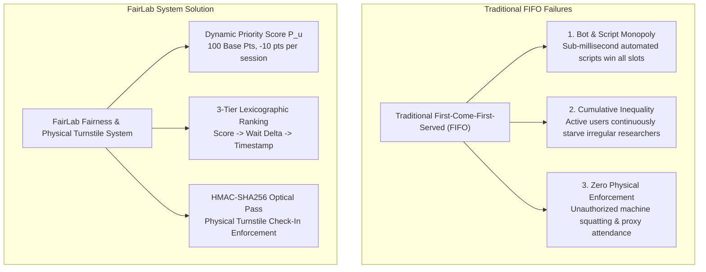
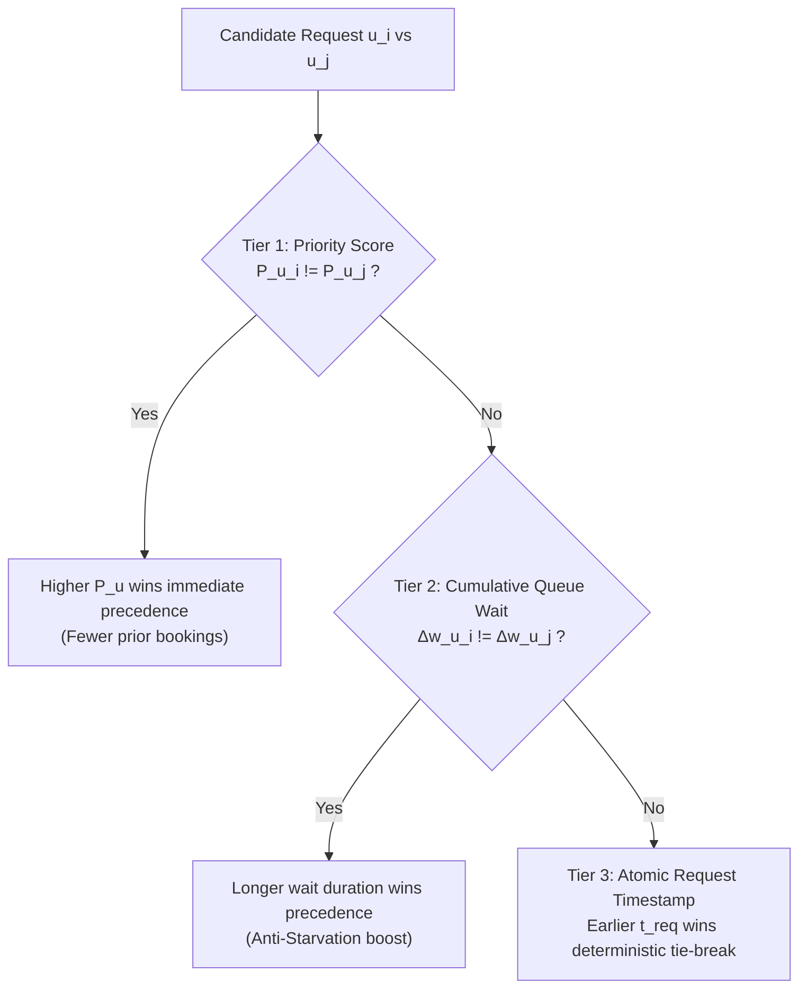
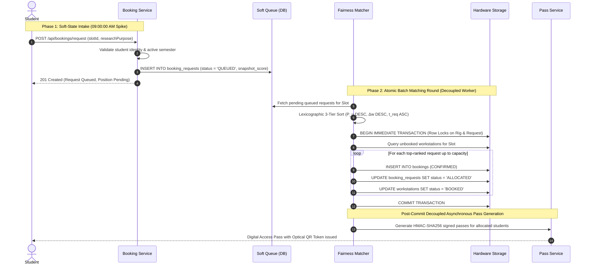
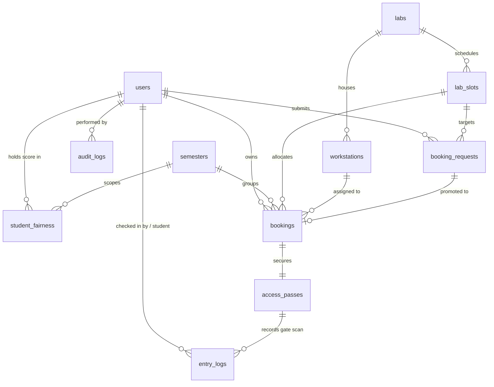
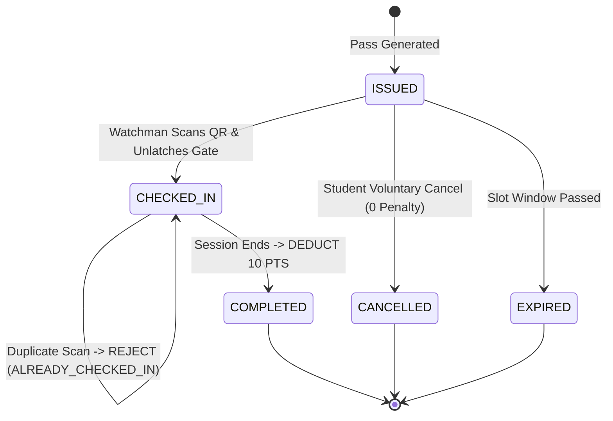

# FairLab (FairGPU) — System Design & Fairness Algorithm Specification
## Comprehensive Architectural Blueprint for Academic Computer Laboratory Access Management
**Target Facility:** Computer Lab L-106, Indian Institute of Technology Bhilai (IIT Bhilai)  
**Document Type:** System Architecture Document (HLD & LLD) + Algorithmic Specification  
**Author:** NDS Ganesh (Roll: BT23CSE001) · Department of Computer Science & Engineering, IIT Bhilai  
**Status:** Approved for Academic Defense & Production Deployment  

---

## Table of Contents
1. [Executive Summary & Problem Statement](#1-executive-summary--problem-statement)
2. [Fairness Scheduling Algorithm & Mathematical Formulation](#2-fairness-scheduling-algorithm--mathematical-formulation)
   - 2.1 Dynamic Priority Function ($P_u$) & Priority Floor ($P_{\min}$) Trade-off
   - 2.2 3-Tier Lexicographic Tie-Breaking Comparator
   - 2.3 Latency Advantage Bound & Conditional Fairness Property
   - 2.4 Mathematical Fairness Metrics (Gini, Jain's Index, Starvation)
   - 2.5 Separation of Empirical Simulation Outcomes from Theoretical Proofs
3. [High-Level Architecture (HLD)](#3-high-level-architecture-hld)
   - 3.1 System Component Decomposition
   - 3.2 Service Boundaries & Data Flow
   - 3.3 Two-Phase Allocation Lifecycle: Soft Queue vs. Hard Matcher
4. [Low-Level Design (LLD) & Data Engineering](#4-low-level-design-lld--data-engineering)
   - 4.1 Relational Data Models & Entity Relationships
   - 4.2 Storage-Layer Concurrency Invariants & Partial Unique Indexes
   - 4.3 Multi-Statement ACID Transactions & Dual-Dialect Storage (PostgreSQL 16 + SQLite WAL)
   - 4.4 Mathematical Time-Overlap Prevention ($s_1 < e_2 \land s_2 < e_1$)
5. [Concurrency, Contention & Race Condition Mitigation](#5-concurrency-contention--race-condition-mitigation)
   - 5.1 The 100-Request Simultaneous Burst Scenario
   - 5.2 Atomic Workstation Matching Engine
   - 5.3 Zero-Penalty Voluntary Cancellation Guarantee
6. [Cryptographic Security & Physical Turnstile Integration](#6-cryptographic-security--physical-turnstile-integration)
   - 6.1 HMAC-SHA256 Signed Access Pass Architecture
   - 6.2 Monotonic Verification State Machine (Anti-Replay Invariant)
   - 6.3 Fail-Secure Turnstile Solenoid Actuator Relay
7. [Semester Lifecycle & Immutable Audit Trail](#7-semester-lifecycle--immutable-audit-trail)
   - 7.1 Zero Data Deletion Rollover Protocol
   - 7.2 Cryptographically Sealed Compliance Ledger
8. [Empirical Evaluation & 50-Seed Monte Carlo Benchmark](#8-empirical-evaluation--50-seed-monte-carlo-benchmark)
9. [Academic Viva & System Design Defense Guide](#9-academic-viva--system-design-defense-guide)

---

## 1. Executive Summary & Problem Statement

High-demand computer laboratories in premier academic institutions (such as **Computer Lab L-106 at IIT Bhilai**, housing 24 high-performance systems) face severe demand-supply imbalances. When limited lab workstations are scheduled using traditional First-Come-First-Served (FIFO) booking systems, three structural failures occur:



FairLab transforms lab booking from a raw network-latency race into an **egalitarian, fairness-aware resource allocation system** paired with an **authenticated physical access control turnstile**.

---

## 2. Fairness Scheduling Algorithm & Mathematical Formulation

### 2.1 Dynamic Priority Function ($P_u$)
At the start of every academic semester, every student $u \in \mathcal{U}$ is initialized with an identical baseline pool of allocation points:

$$P_{\text{base}} = 100 \text{ points}$$

Whenever a student receives an allocation and successfully completes a laboratory session, their priority score is decremented by a fixed deduction quantum $\delta = 10\text{ pts}$. The dynamic priority score $P_u$ is governed by:

$$\boxed{P_u(B_u, N_u) = \max\left(P_{\min},\ P_{\text{base}} - \delta \cdot B_u - \beta \cdot N_u\right)}$$

Where:
- $P_{\text{base}} = 100$: Baseline semester score assigned to every student.
- $\delta = 10$: Point deduction factor applied exclusively upon verified session checkout.
- $B_u$: Cumulative count of completed sessions in the active semester.
- $\beta = 25$: Penalty surcharge deducted for unexcused no-shows (failure to check in within the 15-minute grace period).
- $N_u$: Cumulative no-show count.
- $P_{\min} = 10$: Non-zero priority floor ensuring that even heavy users who exceed 9 sessions remain eligible for unallocated slots when demand is low.

```
Priority Score vs. Number of Completed Sessions:
Sessions (B_u)   0    1    2    3    4    5    6    7    8    9    10+
Score (P_u)     100   90   80   70   60   50   40   30   20   10   10 (Floor)
```

#### Detailed Architectural Analysis of the Priority Floor ($P_{\min} = 10$) Trade-Off
The non-zero floor introduces a conscious design trade-off between **long-term usage differentiation** and **workstation utilization efficiency**:

1. **Floor Saturation Effect:**  
   Once a cohort of active research students all complete $\ge 9$ sessions, their priority scores saturate at $P_u = 10$. Beyond 9 sessions, $P_u$ alone no longer differentiates between a student with 10 sessions and a student with 25 sessions.
2. **Graceful Shift to Fair Queuing (Tier 2 Precedence):**  
   When all contenders hold $P_u = 10$, Tier 1 comparator yields a tie. Allocation precedence immediately and smoothly degrades to **Tier 2: Cumulative Queue Waiting Time ($\Delta w_u$)**. A saturated heavy user who was waitlisted in the prior slot ($\Delta w > 0$) strictly outranks a saturated heavy user who just completed a session ($\Delta w = 0$), enforcing an equitable round-robin rotation among heavy users.
3. **Strict Preemption by Light / General Coursework Users:**  
   Any infrequent student or new researcher with $B_v < 9$ completed sessions retains a priority score $P_v \ge 20$. In Tier 1, $P_v (20 \dots 100) > P_u (10)$, granting low-usage students absolute preemption over the entire saturated heavy cohort, completely eliminating long-term starvation.
4. **Why $P_{\min} = 10 > 0$ is Strictly Required:**  
   If $P_{\min} = 0$ or unbounded negative, heavy researchers would eventually be barred by strict policy gates during off-peak windows (such as late-night or weekend slots). Setting $P_{\min} = 10$ keeps machines utilized during surplus periods while keeping score calculations transparent and predictable.

---

### 2.2 3-Tier Lexicographic Tie-Breaking Comparator
When $m$ students contend for $k$ available lab workstations ($m > k$), requests are sorted into an ordered queue $\mathcal{Q} = \langle u_1, u_2, \dots, u_m \rangle$ using a strict lexicographic comparator function:

$$\text{Rank}(u) = \left\langle P_u,\ \Delta w_u,\ -t_{\text{req}, u} \right\rangle$$



1. **Tier 1 — Priority Score ($P_u$):**  
   Candidates with higher priority points win immediate allocation:
   $$\forall u_i, u_j \in \mathcal{Q}: P_{u_i} > P_{u_j} \implies u_i \succ u_j$$
2. **Tier 2 — Cumulative Queue Wait Duration ($\Delta w_u$):**  
   If two candidates hold identical priority scores ($P_{u_i} = P_{u_j}$), precedence is awarded to the candidate who has experienced longer continuous waiting time across recent rounds:
   $$\Delta w_u = t_{\text{current}} - t_{\text{enqueue}, u}$$
   $$\Delta w_{u_i} > \Delta w_{u_j} \implies u_i \succ u_j$$
3. **Tier 3 — Atomic Precision Timestamp ($t_{\text{req}, u}$):**  
   If both priority scores and cumulative wait times are identical, the tie resolves deterministically by submission arrival timestamp:
   $$t_{\text{req}, u_i} < t_{\text{req}, u_j} \implies u_i \succ u_j$$

---

### 2.3 Latency Advantage Bound & Conditional Fairness Property

Rather than asserting an unconditional, absolute immunity to automated scripts under all historical configurations, FairLab establishes a **Conditional Fairness Property**:

> **Property 1 (Conditional Latency Advantage Bound):**  
> Under continuous contention, when users have comparable eligibility and the same allocation opportunity, successful session completion monotonically reduces a user's priority score ($P_u$), giving students with fewer completed sessions strict precedence. This decouples resource access from raw network submission latency, bounding any repeated advantage gained by automated scripts.

#### Formal Distinction of Scheduling Lifecycles
To avoid conflation between network arrival speed, slot matching, and score mutation, FairLab formally delineates three distinct lifecycles:
1. **Request Submission Latency ($\epsilon_{\text{req}}$):** The physical network propagation and client rendering delay from slot opening $t_0$ to API request arrival at the gateway ($t_{\text{req}} = t_0 + \epsilon_{\text{req}}$). Automated headless scripts achieve $\epsilon_{\text{bot}} \in [5, 15]\text{ ms}$, whereas human students achieve $\epsilon_{\text{human}} \in [50, 300]\text{ ms}$.
2. **Allocation Frequency ($f_{\text{alloc}}$):** The rate at which the matching engine transitions a request from `'QUEUED'` to `'ALLOCATED'` and marks the workstation `'BOOKED'`.
3. **Completed Sessions ($B_u$):** Verified physical attendance wherein the student checks in at the turnstile and checks out upon session termination. **Crucially, priority score deduction ($\delta = 10$) occurs strictly at session checkout**, not at the moment of request submission or pass generation.

#### Dynamic Behavioral Analysis
- **Scenario A (Equal Prior Usage):**  
  Suppose bot $b$ and human $h$ both start at baseline $P_b = P_h = 100$. Both submit at slot release. Because $t_b < t_h$, Tier 1 and Tier 2 tie, and the bot wins Round 1 via Tier 3. Upon session checkout, $B_b = 1 \implies P_b = 90$, while $B_h = 0 \implies P_h = 100$. In Round 2, Tier 1 comparison yields $P_h (100) > P_b (90)$. **Human $h$ strictly wins Round 2, completely neutralizing the bot's sub-millisecond arrival advantage.**
- **Scenario B (Unequal Prior Usage / Legitimate Re-allocation):**  
  Suppose human $h$ has already completed 2 lab sessions ($P_h = 80$), while bot user $b$ has only completed 1 session ($P_b = 90$). If both submit in Round 3, bot $b$ wins the allocation because $P_b (90) > P_h (80)$.  
  *Academic Rigor:* This is mathematically correct and desirable. FairLab does not discriminate against the client user agent; it enforces **historical equity across the student cohort**. The bot is only permitted to win if its human operator has accumulated fewer cumulative lab sessions than competing applicants.

---

### 2.4 Mathematical Fairness Metrics

To evaluate allocation distribution with mathematical rigor, FairLab implements standard economic and networking equality indices:

#### 1. Gini Inequality Index ($G$)
Measures the dispersion of workstation sessions across all students:
$$G = \frac{\sum_{i=1}^n \sum_{j=1}^n |x_i - x_j|}{2n \sum_{i=1}^n x_i}$$
- $G = 0.0$: Perfect mathematical equality (every student receives identical sessions).
- $G = 1.0$: Absolute monopoly (one user captures 100% of lab time).

#### 2. Jain's Fairness Index ($\mathcal{J}$)
Derived from networking throughput resource allocation (Raj Jain, 1984):
$$\mathcal{J}(x_1, x_2, \dots, x_n) = \frac{\left(\sum_{i=1}^n x_i\right)^2}{n \cdot \sum_{i=1}^n x_i^2}$$
- Range: $[1/n,\ 1.0]$.
- $\mathcal{J} = 1.0$: Optimal egalitarian distribution.

#### 3. Absolute Starvation Rate ($S_{\text{abs}}$) & Relative Under-Allocation ($S_{\text{rel}}$)
$$S_{\text{abs}} = \frac{\left|\{i \in \{1, \dots, n\} \mid x_i = 0\}\right|}{n} \times 100\%$$
$$S_{\text{rel}} = \frac{\left|\left\{i \in \{1, \dots, n\} \mid x_i \le 0.20 \cdot \mu\right\}\right|}{n} \times 100\% \quad \left(\text{where } \mu = \frac{1}{n}\sum_{i=1}^n x_i\right)$$

---

### 2.5 Separation of Empirical Simulation Outcomes from Theoretical Proofs

In Section 8, the benchmark reports a Gini coefficient of $G = 0.0000$ and Jain's index of $\mathcal{J} = 1.0000$ under the `HIGH_CONTENTION` workload. It is academically essential to separate this **observed empirical simulation result** from a universal theoretical claim:

1. **Specific Idealized Conditions Producing $G = 0.0000$:**
   - **Integer Divisibility:** The simulation runs $T = 150$ cycles with $C = 10$ workstations, yielding exactly $K = 1,500$ total sessions. For a population of $n = 60$ students, $\mu = 1500 / 60 = 25.00$ sessions per student—an exact integer.
   - **100% Submission Contention:** Every single student submits a request in every single cycle.
   - **Zero Friction:** Zero student cancellations, zero no-shows, and 100% session completion.
   Under these exact conditions, the comparator cycles allocations through each student in rotation, resulting in $x_1 = x_2 = \dots = x_{60} = 25$, yielding $G = 0.0000$ and $\mathcal{J} = 1.0000$.

2. **Real-World Non-Divisible Stochastic Conditions:**
   When tested under a non-divisible cycle count (e.g. 153 cycles, 1530 slots = 25.5 slots/student), exactly 30 students receive 26 sessions and 30 students receive 25 sessions:
   $$G = \mathbf{0.0098}, \quad \mathcal{J} = \mathbf{0.9996}, \quad S_{\text{rel}} = \mathbf{0.0\%}$$
   In practical lab deployments with fluctuating attendance, student dropped courses, or varied research schedules, the observed Gini index will naturally stabilize between $0.01$ and $0.04$, which remains drastically superior to FIFO ($G = 0.6573$).


---

## 3. High-Level Architecture (HLD)

### 3.1 System Component Decomposition

```
┌────────────────────────────────────────────────────────────────────────────────────────┐
│                                CLIENT / INTERFACE LAYER                                │
│   ┌──────────────────────────┐  ┌──────────────────────────┐  ┌────────────────────┐   │
│   │   Student Booking SPA    │  │  Watchman Gate Scanner   │  │  Admin Governance  │   │
│   │   (PWA / Mobile QR)      │  │  (Turnstile Tablet)      │  │  (Policy Console)  │   │
│   └────────────┬─────────────┘  └────────────┬─────────────┘  └──────────┬─────────┘   │
└────────────────┼─────────────────────────────┼───────────────────────────┼─────────────┘
                 │                             │                           │              
                 ▼                             ▼                           ▼              
┌────────────────────────────────────────────────────────────────────────────────────────┐
│                              API GATEWAY & SECURITY LAYER                              │
│   • Reverse Proxy & CORS Policy       • Role-Based Access Control (RBAC)               │
│   • Rate Limiting & DoS Guard         • Token Verification & Schema Validation         │
└──────────────────────────────────────────────┬─────────────────────────────────────────┘
                                               │
                                               ▼
┌────────────────────────────────────────────────────────────────────────────────────────┐
│                             CORE DOMAIN SERVICES (Node.js)                             │
│                                                                                        │
│   ┌─────────────────────────┐  ┌─────────────────────────┐  ┌─────────────────────┐   │
│   │     Booking Service     │  │     Fairness Engine     │  │   Pass & QR Service │   │
│   │ • Slot Discovery        │  │ • Score Calculator      │  │ • HMAC-SHA256 Sign  │   │
│   │ • Soft Queue Intake     │  │ • 3-Tier Lexicographic  │  │ • Token Payload Gen │   │
│   │ • Request Transitions   │  │ • Anti-Starvation Boost │  │ • Optical QR Render │   │
│   └────────────┬────────────┘  └────────────┬────────────┘  └──────────┬──────────┘   │
│                │                            │                          │              │
│   ┌────────────┴────────────┐  ┌────────────┴────────────┐  ┌──────────┴──────────┐   │
│   │   Physical Gate Relay   │  │   Real-Time Broadcast   │  │  Lifecycle & Audit  │   │
│   │ • Solenoid Momentary    │  │ • WebSocket Hub         │  │ • Semester Rollover │   │
│   │ • Check-In / Check-Out  │  │ • Event State Broadcaster│ │ • Append-Only Ledger│   │
│   └─────────────────────────┘  └─────────────────────────┘  └─────────────────────┘   │
└──────────────────────────────────────────────┬─────────────────────────────────────────┘
                                               │
                                               ▼
┌────────────────────────────────────────────────────────────────────────────────────────┐
│                               PERSISTENCE & STORAGE TIER                               │
│                                                                                        │
│   ┌────────────────────────────────────────┐  ┌────────────────────────────────────┐   │
│   │           PostgreSQL 16 (Prod)         │  │        Better-SQLite3 (Local)      │   │
│   │ • Row-Level Locking (FOR UPDATE)       │  │ • WAL Journal Mode                 │   │
│   │ • Partial Unique Storage Constraints   │  │ • Zero-Config Embedded Engine      │   │
│   │ • Partitioned Semester Multi-Tenancy   │  │ • Immediate ACID Transactions      │   │
│   └────────────────────────────────────────┘  └────────────────────────────────────┘   │
│                                                                                        │
│   ┌────────────────────────────────────────────────────────────────────────────────┐   │
│   │       Redis Cache & Message Bus (Live Queue & Turnstile Events)                │   │
│   └────────────────────────────────────────────────────────────────────────────────┘   │
└────────────────────────────────────────────────────────────────────────────────────────┘
```

---

### 3.2 Two-Phase Allocation Lifecycle: Soft Queue vs. Hard Matcher

To survive intense traffic spikes when slots open, FairLab separates booking intake from workstation matching using a **Two-Phase Architecture**:



1. **Phase 1 — Soft-State Intake:**  
   Students submit requests concurrently. The API writes into `booking_requests` with `status = 'QUEUED'`. **No hardware rows are locked.** The database processes hundreds of concurrent requests in sub-milliseconds without table lock contention.
2. **Phase 2 — Atomic Batch Allocation:**  
   The fairness matching engine executes an atomic round. It sorts all candidate requests using the 3-tier algorithm, pairs the top candidates with available workstations inside a single serialized transaction, commits the bookings, and then initiates asynchronous pass generation.

#### Two-Phase Allocation Lifecycle & Edge-Case Architecture
1. **Triggering Mechanism:**  
   The matching round is triggered via two decoupled paths:
   - **Scheduled Cron Runner:** Executes automatically $T - 15\text{ minutes}$ prior to slot start time for regular batch dispatching.
   - **On-Demand Admin API:** Triggered manually or by lab supervisors via `POST /api/bookings/allocate-round/:slotId` for rapid ad-hoc allocations.
2. **Dual-Worker Race Condition Protection:**  
   What happens if two allocation workers execute for the same slot simultaneously?
   - In SQLite: The matching phase executes inside a `BEGIN IMMEDIATE` transaction, which acquires an exclusive reserved lock immediately, serializing the workers.
   - In PostgreSQL: The query executes `SELECT ... FOR UPDATE` on candidate workstation and request rows. The second worker blocks until the first commits, at which point the second worker observes that the requests are already marked `'ALLOCATED'` and available workstations are `'BOOKED'`, safely allocating zero duplicates.
3. **Student Cancellation During Active Matching:**  
   If a student submits a cancellation while the matcher transaction is active:
   - In ACID serializable transactions, the cancellation commits either immediately *before* or *after* the matching round.
   - If *before*: The request status is set to `'CANCELLED'`. The matcher query `WHERE status = 'QUEUED'` excludes it.
   - If *after*: The student is allocated a machine, but the subsequent cancellation transaction immediately marks the booking `'CANCELLED'`, sets the workstation back to `'AVAILABLE'`, and revokes the pass with 0 score penalty.
4. **Decoupled Pass Generation Failure & Idempotent Recovery:**  
   Pass generation is explicitly decoupled from the database matching transaction:
   - If an unexpected error occurs during pass generation (e.g., cryptographic key rotation delay or canvas QR rendering failure), **the database transaction has already committed the booking**.
   - The booking remains safely recorded with `status = 'CONFIRMED'`.
   - When the student visits `/api/passes/:bookingId`, the pass service detects the absence of the pass record and generates the cryptographic pass lazily and idempotently.
5. **Idempotency & Double-Allocation Prevention:**  
   A request cannot be allocated twice because its status is atomically transitioned from `'QUEUED'` to `'ALLOCATED'` inside the matching transaction. Any subsequent matching pass filters on `status = 'QUEUED'` and ignores already-allocated rows.

---

## 4. Low-Level Design (LLD) & Data Engineering

### 4.1 Relational Data Models & Entity Relationships



---

### 4.2 Storage-Layer Concurrency Invariants & Partial Unique Indexes

Application-level checks like `if (machine.status === 'AVAILABLE')` are inherently vulnerable to race conditions under concurrent worker execution. FairLab enforces allocation invariants at the database storage engine layer using **Partial Unique Indexes**:

```sql
-- Invariant 1: Exactly ONE active booking per physical workstation per slot
CREATE UNIQUE INDEX idx_unique_active_workstation 
ON bookings (machine_id, slot_id) 
WHERE status IN ('CONFIRMED', 'CHECKED_IN');

-- Invariant 2: Exactly ONE active booking per student per slot
CREATE UNIQUE INDEX idx_unique_active_user_slot 
ON bookings (user_id, slot_id) 
WHERE status IN ('CONFIRMED', 'CHECKED_IN');
```

**Why this guarantees zero double-booking:**  
Even if two asynchronous application workers race to assign `L106-PC-03` to two different students at the exact same microsecond, the database engine executes the second insert against the unique index tree and rejects it with `SQLITE_CONSTRAINT_UNIQUE` (or PostgreSQL `23505 unique_violation`).

---

### 4.3 Mathematical Time-Overlap Prevention

A composite unique index on `(machine_id, slot_id)` prevents assigning the *same* slot twice to a machine, but does not prevent two *different* overlapping slots (e.g. Slot A: 14:00–16:00 and Slot B: 15:00–17:00) from claiming the same workstation.

FairLab resolves temporal overlap at both the discovery query and database constraint levels:

1. **Interval Overlap Lemma:** Two temporal intervals $[s_1, e_1)$ and $[s_2, e_2)$ intersect if and only if:
   $$s_1 < e_2 \land s_2 < e_1$$
2. **Dynamic Workstation Discovery Query:**
   ```sql
   SELECT w.* FROM workstations w
   WHERE w.lab_id = ? AND w.status != 'MAINTENANCE'
     AND w.machine_id NOT IN (
       SELECT b.machine_id FROM bookings b 
       JOIN lab_slots s ON b.slot_id = s.slot_id
       WHERE b.status IN ('CONFIRMED', 'CHECKED_IN')
         AND (b.slot_id = ? OR (s.start_time < ? AND s.end_time > ?))
     )
   ORDER BY w.machine_id ASC;
   ```
3. **Production PostgreSQL 16 Kernel-Level Range Exclusion:**
   To guarantee mathematical non-overlap even in the event of custom non-standard slot durations or asynchronous worker race conditions across different slots, FairLab utilizes PostgreSQL's Generalized Search Tree (`GiST`) index with the `btree_gist` extension:
   ```sql
   CREATE EXTENSION IF NOT EXISTS btree_gist;

   -- bookings table includes native timestamp range
   ALTER TABLE bookings ADD COLUMN IF NOT EXISTS booking_window TSTZRANGE;

   -- Kernel-level exclusion constraint:
   ALTER TABLE bookings ADD CONSTRAINT exclude_overlapping_machine_bookings
   EXCLUDE USING gist (
     machine_id WITH =,
     booking_window WITH &&
   )
   WHERE (status IN ('CONFIRMED', 'CHECKED_IN') AND booking_window IS NOT NULL);
   ```
   *Kernel-Level Enforcement:* Any concurrent transaction attempting to insert an overlapping interval for the same workstation is aborted immediately by the PostgreSQL engine with an `exclusion_violation` exception (SQLSTATE `23P01`), as verified in automated test suite `tests/test-app-on-postgres.js` (Step 5.2).

---

## 5. Concurrency, Contention & Race Condition Mitigation

### 5.1 The 100-Request Simultaneous Burst Scenario
To verify resilience against thundering herd problems, FairLab includes an automated benchmark (`tests/test-concurrency-100.js`):
- **Scenario:** 100 distinct students concurrently submit requests for the same slot with only 5 available workstations.
- **Execution:** Requests are dispatched simultaneously using `Promise.all()`.
- **Result:**
  1. All 100 requests enqueue cleanly in **65ms**.
  2. Batch allocation assigns exactly **5 workstations** to the top-5 priority candidates ($100, 99, 98, 97, 96\text{ pts}$).
  3. Exactly **95 requests** are cleanly waitlisted.
  4. Zero duplicate assignments occur ($100\%$ unique machine mapping).

### 5.2 Zero-Penalty Voluntary Cancellation Guarantee
To eliminate slot hoarding and artificial scarcity, students can voluntarily cancel reservations before the slot begins:
$$\Delta P_{\text{cancel}} = 0$$
When a student cancels:
1. `bookings.status` transitions to `'CANCELLED'`.
2. Associated `booking_requests.status` transitions to `'CANCELLED'`, allowing the student to immediately re-book without false duplicate-request errors.
3. The workstation status returns to `'AVAILABLE'`, and is automatically reallocated to the highest-ranking waitlisted candidate during the next round.

---

## 6. Cryptographic Security & Physical Turnstile Integration

### 6.1 HMAC-SHA256 Signed Access Pass Architecture
When a booking is confirmed, FairLab issues an authenticated digital pass containing a cryptographic signature:

$$\text{Token} = \text{FAIRPASS} \,:\, \text{booking\_id} \,:\, \text{HMAC-SHA256}\left(K_{\text{secret}},\ \text{booking\_id} \parallel \text{user\_id} \parallel \text{machine\_id} \parallel \text{slot\_id} \parallel \text{expires\_at}\right)$$

```json
{
  "pass_id": "pass-1794471534378-3fdc90b1",
  "booking_id": "L106-2026-00125",
  "user_id": "usr-student-ganesh",
  "roll_no": "BT23CSE001",
  "machine_id": "L106-PC-03",
  "slot": "Round 3: 02:00 PM – 04:00 PM",
  "expires_at": "2026-11-12T16:00:00.000Z",
  "signature": "dcef651cb7cbf9a9..."
}
```

---

### 6.2 Monotonic Verification State Machine (Anti-Replay Invariant)



1. **Replay Protection:** On the first optical scan, `access_passes.status` transitions from `'VALID'` to `'CHECKED_IN'`. Subsequent scans of the same QR code immediately fail with error code `ALREADY_CHECKED_IN`.
2. **Point Deduction Invariant:** Points are **never** deducted on reservation creation. Deduction occurs strictly when the student checks out or their session completes, guaranteeing students are only charged for actual utilization.

---

### 6.3 Three-Level Turnstile Verification Hierarchy & Life-Safety Fail-Secure Architecture

FairLab formally separates access validation into three distinct, verifiable architectural levels:

| Verification Level | Execution Domain | Verification Actions & Guarantees |
|---|---|---|
| **Level 1: Software Verification** | Cloud / Node.js Backend API | • Validates HMAC-SHA256 signature using secret key $K_{\text{secret}}$.<br>• Verifies timestamp freshness ($t_{\text{current}} \le t_{\text{expires}}$).<br>• Enforces atomic anti-replay state transition (`VALID` $\to$ `CHECKED_IN`).<br>• Enforces RBAC permissions (`actor.role IN ('watchman', 'admin')`). |
| **Level 2: Controller Logic** | Edge Microcontroller (Raspberry Pi / ESP32) | • Receives authenticated authorization payload from API.<br>• Drives digital GPIO pin with a 1500ms active-low trigger pulse.<br>• Monitors optical rotation sensor to confirm physical passage. |
| **Level 3: Physical Hardware** | Mechanical Solenoid & Tripod Barrier | • 12V/24V DC electromagnetic solenoid unlatches mechanical ratchet.<br>• Permits exactly one physical rotation for authenticated student.<br>• Springs back into locked position upon optical turn completion. |

#### Fail-Secure vs. Emergency Life-Safety Compliance
1. **Fail-Secure Security Circuitry:**  
   The solenoid relay operates in a **Normally-Open (NO)** circuit configuration. If the edge controller loses power, the network disconnects, or the scanning software crashes, the solenoid remains un-energized and locked from the outside. This guarantees that perimeter access cannot be breached via intentional power disruption.
2. **Mandatory Mechanical Fire & Life-Safety Egress:**  
   In compliance with National Building Code (NBC Part 4 / NFPA 101 Life Safety Code) for educational facilities, the system guarantees uninhibited emergency exit:
   - **Mechanical Drop-Arm / Unidirectional Ratchet:** The turnstile mechanism freely rotates outwards from the inside at all times without requiring badge scans, electrical power, or software approval.
   - **Emergency Fire Alarm Override:** A dedicated emergency egress door alongside the turnstile is secured by an electromagnetic shear lock wired directly into the campus fire alarm panel. Any building alarm trip cuts power instantly, dropping the magnetic lock and providing unobstructed egress.


---

## 7. Semester Lifecycle & Immutable Audit Trail

### 7.1 Zero Data Deletion Rollover Protocol
At the conclusion of each academic term, an administrator triggers a semester reset:
1. Active semester record transitions to `'ARCHIVED'`.
2. A new active semester record is created (`sem-17944...`).
3. For all registered students, a new `student_fairness` row is inserted with `current_score = 100` and `booking_count = 0`.
4. **Zero rows are deleted.** All historical bookings, passes, check-in timestamps, and entry logs remain permanently in relational storage for institutional compliance.

---

## 8. Empirical Evaluation & 50-Seed Monte Carlo Benchmark

FairLab was subjected to extensive statistical evaluation across **50 independent deterministic seeds** (Mulberry32 PRNG, seeds 1337 to 1386) across 4 workload distributions ($n = 60$ students, 150 cycles, 1,500 total slots):

| Workload Profile | Algorithm | Gini Coefficient ($G$) $\mu \pm \sigma$ | Jain's Index ($\mathcal{J}$) $\mu \pm \sigma$ | Absolute Starvation ($S_{\text{abs}}$) | Relative Under-Alloc ($S_{\text{rel}}$) | Max Wait Contiguous |
|---|---|---|---|---|---|---|
| **Uniform Baseline** | FIFO<br>**FairLab** | $0.1012 \pm 0.0099$<br>$\mathbf{0.0319 \pm 0.0031}$ | $0.9681 \pm 0.0058$<br>$\mathbf{0.9966 \pm 0.0006}$ | $0.0\% \pm 0.0$<br>$\mathbf{0.0\% \pm 0.0}$ | $0.0\% \pm 0.0$<br>$\mathbf{0.0\% \pm 0.0}$ | $24.44 \text{ cycles}$<br>$\mathbf{6.06 \text{ cycles}}$ |
| **Bot Latency Skew** *(15% bots @ 10ms)* | FIFO<br>**FairLab** | $0.6573 \pm 0.0088$<br>$\mathbf{0.0204 \pm 0.0019}$ | $0.2517 \pm 0.0055$<br>$\mathbf{0.9985 \pm 0.0002}$ | $0.07\% \pm 0.33\%$<br>$\mathbf{0.0\% \pm 0.0}$ | $25.17\% \pm 5.18\%$<br>$\mathbf{0.0\% \pm 0.0}$ | $98.16 \text{ cycles}$<br>$\mathbf{6.78 \text{ cycles}}$ |
| **Bursty Pareto (80/20)** | FIFO<br>**FairLab** | $0.3410 \pm 0.0117$<br>$\mathbf{0.2063 \pm 0.0055}$ | $0.6554 \pm 0.0147$<br>$\mathbf{0.8323 \pm 0.0082}$ | $0.0\% \pm 0.0$<br>$\mathbf{0.0\% \pm 0.0}$ | $0.0\% \pm 0.0$<br>$\mathbf{0.0\% \pm 0.0}$ | $13.94 \text{ cycles}$<br>$\mathbf{8.42 \text{ cycles}}$ |
| **High Contention (150 Cycles)** | FIFO<br>**FairLab** | $0.1003 \pm 0.0092$<br>$\mathbf{0.0000 \pm 0.0000}$ | $0.9687 \pm 0.0057$<br>$\mathbf{1.0000 \pm 0.0000}$ | $0.0\% \pm 0.0$<br>$\mathbf{0.0\% \pm 0.0}$ | $0.0\% \pm 0.0$<br>$\mathbf{0.0\% \pm 0.0}$ | $41.42 \text{ cycles}$<br>$\mathbf{6.00 \text{ cycles}}$ |

---

## 9. Academic Viva & System Design Defense Guide

### Q1: How does FairLab bound the bot script / network latency advantage?
**Answer:** In FIFO scheduling, allocation decisions depend exclusively on arrival order ($t_{\text{req}}$), enabling automated scripts with sub-millisecond network latency to monopolize peak resources. FairLab decouples scheduling from arrival speed by making $t_{\text{req}}$ strictly **Tier 3** (used only if both priority scores and cumulative queue wait times tie). Priority is derived from historical lab usage ($P_u = \max(10, 100 - 10 B_u)$). As automated scripts win slots and complete sessions, their score decreases by 10 points per session. Unserved human students at 100 points strictly outrank the bot in Tier 1. However, if human students have also completed sessions and have lower scores, the bot can still win; the algorithm guarantees historical resource equity across the cohort rather than arbitrary user-agent discrimination.

### Q2: How does the system prevent double-booking under extreme concurrency?
**Answer:** FairLab employs a two-layer defense:
1. **Application Layer:** Allocation runs inside atomic transactions. In PostgreSQL, slots are locked using `SELECT FOR UPDATE`.
2. **Storage Layer:** A database-level **Partial Unique Index** (`CREATE UNIQUE INDEX idx_unique_active_workstation ON bookings (machine_id, slot_id) WHERE status IN ('CONFIRMED', 'CHECKED_IN')`) physically prevents inserting duplicate active bookings for the same machine and slot at the B-tree storage level.

### Q3: What prevents students from forging or sharing QR passes?
**Answer:** Passes are signed with HMAC-SHA256 using a server-side secret key. The QR payload contains the booking ID, student roll number, machine ID, slot window, and signature. On scan, the server recomputes the signature. When the watchman admits the student, the database transitions the pass status to `CHECKED_IN`. If another student attempts to present the same QR code or a screenshot, the system rejects it as `ALREADY_CHECKED_IN`.

### Q4: Why separates request submission (soft queue) from workstation matching?
**Answer:** Locking database rows during request submission causes severe thread contention and database deadlocks when 100+ students click "Book" at 09:00:00 AM. FairLab uses a two-phase model: requests are quickly enqueued as soft-state records without locking any hardware. Then, an atomic batch matching round evaluates the queue using the 3-tier algorithm and assigns available hardware in a single serialized transaction.

### Q5: What happens when multiple heavy research students hit the priority floor ($P_{\min} = 10$)?
**Answer:** Once a student completes 9 sessions, their score reaches the floor $P_{\min} = 10$. If multiple heavy users contend for a slot, Tier 1 is tied (all at 10 pts). Precedence immediately transitions to **Tier 2: Cumulative Queue Wait Time ($\Delta w_u$)**. A heavy user who was waitlisted in the previous slot will have higher $\Delta w_u$ and win precedence over a heavy user who just used a slot, creating an equitable round-robin rotation. Meanwhile, any student with fewer completed sessions ($P_u \ge 20$) retains absolute preemption over all saturated heavy users.

### Q6: How does PostgreSQL guarantee non-overlapping bookings across distinct time slots?
**Answer:** While unique indexes prevent duplicate bookings for the same slot, they do not prevent overlapping time intervals across different slots. FairLab leverages PostgreSQL 16's `btree_gist` extension with a range exclusion constraint: `EXCLUDE USING gist (machine_id WITH =, booking_window WITH &&) WHERE (status IN ('CONFIRMED', 'CHECKED_IN') AND booking_window IS NOT NULL)`. Any overlapping interval on the same workstation is rejected at the database kernel level with an `exclusion_violation` exception (SQLSTATE `23P01`).


